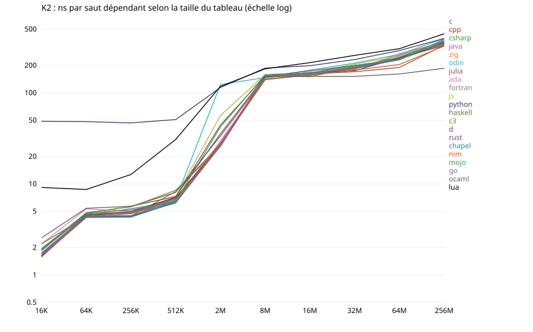

# Quels langages incarnent le mieux la *mechanical sympathy* ? Une étude mesurée (28 octobre 2026, révisée le 29 octobre)

**Réponse courte (v2, 29 octobre).** J'ai mesuré moi-même 21 langages sur des VM Intel, avec neuf noyaux
notés qui testent chacun un principe de la *mechanical sympathy*. Chaque implémentation doit rendre le même
résultat, au bit près pour les entiers ; tout temps inférieur à la borne physique de la machine est rejeté. Le
score combine trois piliers : le **contrôle** offert (C, 35 %), l'**efficacité plafond** mesurée (E, 40 %) et la
qualité du **code par défaut** (D, 25 %). Cette version tient compte d'un audit externe, archivé dans
[`docs/AUDIT_2026-10-29.md`](docs/AUDIT_2026-10-29.md) et vérifié point par point dans
[`docs/AUDIT_RESPONSE.md`](docs/AUDIT_RESPONSE.md). Changements principaux :
* K10 sort du score : sa médiane mesurait la probabilité d'un régime, pas une propriété de langage ;
* la queue de latence est notée en valeur absolue ;
* une même règle de notation des capacités s'applique à tous les langages ;
* les phases d'échauffement sont détectées et écartées ;
* K5 est remesuré avec 9 processus sur une seule machine ;
* une analyse d'incertitude globale (20 000 tirages) et des ensembles de confiance simultanés remplacent les
  intervalles marginaux.

Le plan ([`docs/ANALYSIS_V2.md`](docs/ANALYSIS_V2.md)) a été poussé sur GitHub avant les nouvelles mesures.

**La réponse.**
* **C et C++ incarnent le mieux la *mechanical sympathy* mesurée ici, sans qu'on puisse les départager.**
  * Ce sont les deux seuls langages qui peuvent être premiers : ensembles de confiance simultanés à 95 % de
    C 1–2 et de C++ 1–3.
  * L'un des deux est premier dans 87 % des tirages de l'analyse globale (C 57 %, C++ 30 %), mais C ne précède
    C++ que dans 64 % des tirages.
  * Ce sont aussi les deux seuls langages du front de Pareto sur (C, E, D) : aucun autre n'est au moins aussi bon
    qu'eux sur les trois piliers à la fois.
* **Odin vient ensuite.** Seul C le devance de façon significative à la mesure. Odin est dans les trois premiers
  dans 54 % des tirages, mais premier dans 7 % seulement. Sa première place en v1 tenait à K10 et à l'ancienne
  règle des capacités.
* **Un peloton de six langages qu'on ne sait pas ordonner** : Zig, C3, D, Nim, Rust et Ada (ensembles 3–9 ou
  3–10). Puis **Chapel**, troisième plafond de l'étude mais pauvre en contrôle bas niveau, et **Julia, Fortran,
  Mojo** (10–13).
* **Puis trois étages nets** :
  * C#, Java, Go : ramasse-miettes imposé, compilation optimisante ;
  * Haskell, puis OCaml : langages fonctionnels ;
  * JavaScript, Python, Lua : moteurs dynamiques.

  Les rangs 14 à 21 sont déterminés exactement par les mesures (ensembles réduits à un rang).

La règle de groupement fixée d'avance est stricte : deux langages sont à égalité si leurs ensembles simultanés
se recouvrent, ou si aucun ne précède l'autre dans 90 % des tirages. Avec elle, les 13 premiers forment un seul
groupe, car les ensembles se chevauchent de proche en proche de C (1–2) à Mojo (11–13). Les énoncés plus fins
ci-dessus sont des probabilités, pas un ordre établi.

| Groupe | Langage | MS [IC 95 %] | Ensemble simultané | Rang, analyse globale [5–95 %] | P(3 premiers) | En une ligne (faits mesurés) |
|---|---|---|---|---|---|---|
| 1 | **C** | 79,6 [75,6–79,8] | 1–2 | 1 [1–4] | 92 % | frontière sur K4 et K5 ; meilleur code par défaut (D 1er) ; leviers livrés avec clang et gcc |
| 1 | **C++** | 77,4 [74,0–77,9] | 1–3 | 2 [1–6] | 80 % | le plus de contrôle (C 1er : `std::simd`, `pmr`) ; conteneurs standard à contre-courant |
| 1 | **Odin** | 72,2 [69,5–73,1] | 2–9 | 3 [1–6] | 54 % | DOD dans le langage (`#soa`, `#simd`) ; allocation et queue de latence faibles (K8, D3) |
| 1 | **Zig** | 70,8 [68,5–71,5] | 3–9 | 5 [2–10] | 23 % | contrôle au 3e rang ; aucune boucle naturelle vectorisée |
| 1 | **C3** | 70,8 [68,0–71,2] | 3–9 | 5 [2–9] | 23 % | C avec vecteurs natifs, 2e plafond (E 82,4) ; ni contrôle de la réassociation ni parallélisme de données |
| 1 | **D** | 69,9 [67,4–70,6] | 3–9 | 8 [4–12] | 4 % | contrôle de C avec LDC ; ramasse-miettes par défaut (pause de 127 ms) |
| 1 | **Nim** | 69,8 [67,2–71,3] | 3–9 | 6 [2–9] | 17 % | 2e code par défaut (D 54,8) ; hérite des leviers de C |
| 1 | **Rust** | 69,6 [66,7–70,2] | 3–9 | 7 [4–10] | 2 % | 4e plafond (E 80,2) ; bornes vérifiées, SipHash, SIMD portable en *nightly* |
| 1 | **Ada** | 68,2 [65,6–69,1] | 3–10 | 9 [4–12] | 4 % | meilleure arène (K8 au niveau de la frontière) ; meilleur profil « allocation et prévisibilité » |
| 1 | **Chapel** | 64,2 [61,5–64,5] | 9–12 | 10 [5–13] | 2 % | 3e plafond (parallélisme natif) ; peu de contrôle bas niveau (C 14e) |
| 1 | **Julia** | 62,4 [60,2–63,0] | 10–13 | 11 [7–13] | 0 % | génère du bon code ; ramasse-miettes et runtime (queue de latence 0,09) |
| 1 | **Fortran** | 60,6 [57,4–61,2] | 10–13 | 12 [9–14] | 0 % | stencil et parallélisme ; pas de SIMD explicite ni de contrôle fin |
| 1 | **Mojo** | 60,3 [58,2–61,5] | 11–13 | 12 [10–13] | 0 % | SIMD de premier ordre en optimisé ; boucles naturelles scalaires |
| 2 | **C#** | 54,0 [51,7–54,9] | 14 | 14 [12–16] | 0 % | SIMD explicite proche de C une fois le JIT stabilisé (K5 4,3 ms contre 3,9) ; objets en références |
| 2 | **Java** | 47,1 [44,8–47,8] | 15 | 15 [14–16] | 0 % | meilleure queue de latence absolue (p99,9 134 µs) ; pas de types valeur dans le JDK 27 |
| 2 | **Go** | 43,3 [41,9–43,6] | 16 | 16 [14–16] | 0 % | structs par valeur ; ni SIMD stable, ni vectoriseur, ni ordres mémoire faibles |
| 3 | **Haskell** | 35,5 [34,3–35,8] | 17 | 17 [17–17] | 0 % | peut descendre bas (primops SIMD) ; tout le défaut va à contre-courant |
| 4 | **OCaml** | 25,0 [22,8–25,2] | 18 | 18 [18–18] | 0 % | domaines, bonne queue de latence ; flottants boxés, aucun SIMD |
| 5 | **JavaScript** | 14,7 [13,8–15,1] | 19 | 19 [19–20] | 0 % | tableaux typés ; objets en références (416 o par particule) |
| 6 | **Python** | 10,0 [9,9–10,0] | 20 | 20 [19–21] | 0 % | environ 200 fois plus lent que la frontière ; hiérarchie mémoire invisible |
| 6 | **Lua** | 4,0 [3,7–4,1] | 21 | 21 [20–21] | 0 % | tables seulement : ni types étroits, ni structures en ligne, ni threads |

L'ordre des lignes est celui de la configuration principale. Le groupe applique la règle du plan.
L'IC est l'intervalle de confiance à 95 % de l'incertitude de mesure seule. L'analyse globale fait varier ensemble :
* l'estimateur, les normalisations et les références ;
* l'agrégation et la règle des capacités ;
* le jugement porté sur chaque capacité ;
* tous les poids, internes compris.

Détail : [`results/report_v2.md`](results/report_v2.md).


**Profils par principe** (0–100 ; disposition : K1 et D2 ; SIMD : K5, K4 et vectorisation mesurée ; hiérarchie :
D4 et K9 ; concurrence : K3, K6 et K9 en 4 threads ; allocation : K8 et D3 ; analytique : K6 et K7) :

| Langage | Disposition | SIMD | Hiérarchie | Concurrence | Allocation et prévisibilité | Analytique |
|---|---|---|---|---|---|---|
| C | 97 | 100 | 96 | 87 | 61 | 95 |
| C++ | 96 | 82 | 95 | 84 | 68 | 91 |
| Odin | 97 | 97 | 97 | 71 | 33 | 75 |
| Zig | 97 | 34 | 96 | 81 | 43 | 94 |
| C3 | 100 | 93 | 92 | 83 | 48 | 92 |
| D | 100 | 76 | 95 | 63 | 21 | 73 |
| Nim | 100 | 69 | 98 | 66 | 49 | 66 |
| Rust | 100 | 78 | 96 | 74 | 34 | 85 |
| Ada | 97 | 62 | 85 | 52 | 77 | 76 |
| Chapel | 97 | 92 | 94 | 87 | 38 | 79 |
| Julia | 96 | 88 | 95 | 65 | 20 | 60 |
| Fortran | 99 | 48 | 93 | 81 | 63 | 75 |
| Mojo | 98 | 32 | 89 | 78 | 48 | 83 |
| C# | 65 | 35 | 86 | 62 | 34 | 67 |
| Java | 61 | 48 | 90 | 63 | 56 | 46 |
| Go | 97 | 15 | 62 | 52 | 24 | 62 |
| Haskell | 83 | 28 | 91 | 37 | 9 | 46 |
| OCaml | 47 | 4 | 67 | 17 | 52 | 19 |
| JavaScript | 27 | 4 | 62 | 14 | 9 | 13 |
| Python | 7 | 0 | 7 | 0 | 1 | 1 |
| Lua | 9 | 0 | 20 | 1 | 2 | 3 |

Les profils disent ce qu'un score unique cache.
* Aucun langage n'est en tête partout. C est premier ou presque sur cinq principes sur six ; sa faiblesse relative
  est l'allocation.
* Ada a le meilleur profil « allocation et prévisibilité » (77), devant C++ (68).
* Zig et Mojo s'effondrent sur le SIMD (34 et 32), Odin et D sur l'allocation (33 et 21).
* Go garde la disposition (structs par valeur, 97) mais perd le SIMD (15).


**Ce qui change par rapport à la v1, et pourquoi.**
* **Odin passe de 1er à 3e.** Il était premier de 0,36 point, grâce à K10 (régime rapide dans 59 % des
  répétitions, contre 9 % pour C).
* **C et C++ remontent**, pour deux raisons :
  * la règle unique des capacités compte désormais ce que livre leur chaîne (OpenMP, `vector_size`,
    `__builtin_prefetch`, `mmap`…), d'où un pilier C de 76,3 à 88,7 pour C et de 84,7 à 92,4 pour C++ ;
  * la sortie de K10 lève le pire noyau de C (0,16 en v1).
* **Chapel passe de 6e à 10e**, D de 8e à 6e, Julia de 13e à 11e. Le bas du classement ne bouge pas.
* **Aucun choix pris isolément ne déplace un langage de plus de trois rangs** (tableau de décomposition dans
  `results/report_v2.md`). C est premier dans dix variantes sur onze ; C++ l'est dans la onzième (avec K10).
  C'est la **combinaison** des choix de la v1 qui mettait Odin en tête.
* **La détection de l'échauffement ne change aucun rang.** La remesure de K5, avec 10 répétitions
  d'échauffement pour les JIT, corrige C# : son K5 optimisé descend à 4,3 ms, contre 3,9 ms pour C. La v1 le
  mesurait à 17 ms, pendant la recompilation du JIT, sur la machine 2.

**Langage ou implémentation ?** Le score mesure un langage avec son compilateur de référence, sa bibliothèque
standard et mes implémentations.
* À source égale, C compilé par gcc obtient 78,5 au lieu de 79,6 avec clang, et Fortran 60,2 avec flang au lieu de
  60,6 avec gfortran. L'écart de Fortran, 5,8 points en v1, venait surtout de K10.
* Le backend pèse sur certains noyaux.
  * Sur K8 (allocation, meilleure variante), les implémentations compilées par GCC (C, C++, Fortran, Ada)
    obtiennent 0,56 à 1,00 ; celles compilées par LLVM obtiennent 0,31 à 0,55, Haskell mis à part.
  * Une expérience à algorithme égal le confirme : le compilateur fait un facteur 2,2 à 2,7, le style de codage
    20 à 30 % (`docs/AUDIT_RESPONSE.md`).
* Sur la machine 3, quatre compilateurs fusionnent `s += a[i] * b[i]` en une FMA scalaire : clang pour C, flang,
  Chapel et Mojo (code machine vérifié). Ils doublent ainsi le temps du produit scalaire naturel.
  * Avec FMA : 160 à 166 ms ; sans FMA, dans les autres langages compilés : 77 à 87 ms.
  * L'ordre strict impose une chaîne de dépendances. Sur ce cœur, chaque maillon coûte 2 cycles avec une addition
    et 4 avec une FMA (mesuré : `tools/addfma.c`).
  * Sur Cascade Lake (machine 1), les deux opérations ont la même latence : le choix ne changeait rien.

**Réplication sur une autre microarchitecture.** J'ai refait toutes les mesures notées sur la machine 3 (Emerald
Rapids), avec un seul processus par mesure (K5 garde ses 9 processus).
* Le classement recalculé avec ces seules données suit le classement v2 : corrélation de Spearman 0,93. Les huit
  derniers rangs sont identiques, et aucun langage ne sort de son groupe.
* L'ordre à l'intérieur du premier groupe change : C++ 1er, Rust 2e, C 3e, Nim 4e, Odin 7e, Zig 9e. Le plus
  grand déplacement est celui de Rust (6 rangs).
* Une bonne part de ce mouvement vient de K3, l'écrivain unique. Sur ce cœur, la même boucle d'incréments en
  mémoire prend 1 ou 7 cycles par incrément selon son seul alignement dans le code. Je l'ai vérifié à 16 décalages
  (`tools/k3_align.c`).
  * Les boucles de Rust, de C (clang) et d'Odin sont octet pour octet les mêmes. Celle de Rust tombe sur un bon
    alignement (13 ms), celles de C et d'Odin sur un mauvais (76 et 79 ms).
  * C'est donc le placement du code (compilateur et éditeur de liens) qui décide, pas le langage.
  * Sur Cascade Lake, ce mécanisme n'existait pas : 58 à 70 ms pour tous.
* Mesure par mesure, la corrélation de rang entre les deux machines est forte là où les langages diffèrent
  vraiment (K4, K6, K8, K9 : 0,77 à 0,97). Elle est faible là où les langages compilés sont tous à la borne
  matérielle (K1 `aos` et `soa` : 0,32 et 0,56 ; K2 : 0 à 0,56) : leur ordre y tient au bruit.

**Ce que la v2 ne règle pas.**
* Une seule machine par noyau, partagée et sans compteurs matériels.
* Deux ou trois processus par mesure hors K5.
* Des implémentations d'un seul auteur, d'effort inégal.
* Aucun noyau d'E/S ni de *smart batching*.
* K10 et la queue de latence en boucle fermée.

Les limites et ce qui reste à faire sont listés dans la section 7 et dans `docs/AUDIT_RESPONSE.md`.

<details>
<summary><b>Réponse v1 du 28 octobre (analyse pré-enregistrée), conservée telle quelle</b> : ses défauts sont discutés dans <code>docs/AUDIT_RESPONSE.md</code></summary>

**Réponse courte (v1).** J'ai mesuré moi-même les 21 langages sur une même VM, avec dix noyaux qui
testent chacun un principe de la *mechanical sympathy* (un redémarrage de la VM en cours de route
est traité en section 7). Chaque implémentation doit rendre le même résultat : au bit près pour
les entiers, à 10⁻⁶–10⁻³ près pour les flottants. Tout temps inférieur à la borne physique de la
machine est rejeté. J'ai
ajouté 34 capacités, vérifiées dans la documentation officielle et par 21 sondes compilées et
exécutées. Le score combine trois piliers : le **contrôle** offert (C, 35 %), l'**efficacité
plafond** mesurée (E, 40 %) et la qualité du **code par défaut** (D, 25 %). Le classement forme
des groupes nets. **À l'intérieur d'un groupe, l'ordre n'est pas significatif** : il change
selon les poids et le bruit de mesure (intervalles de rang, section 6).

| Rang | Langage | Score MS | Rang 5–95 % | En une ligne (faits mesurés) |
|---|---|---|---|---|
| 1 | **Odin** | 72,3 | 1–4 | DOD dans le langage (`#soa`, `#simd`) ; code par défaut contigu et vectorisé |
| 2 | **C++** | 71,9 | 1–4 | le plus de contrôle (`std::simd` C++26, `pmr`) ; conteneurs standard à contre-courant |
| 3 | **C** | 69,3 | 1–4 | code par défaut le plus proche du matériel (D 1er) ; leviers souvent hors norme |
| 4 | **C3** | 66,8 | 4–8 | C plus vecteurs natifs et génériques ; mêmes qualités par défaut que C |
| 5 | **Zig** | 66,7 | 3–10 | capacités au 2e rang, mais aucune boucle naturelle vectorisée |
| 6 | **Chapel** | 65,5 | 1–11 | meilleure efficacité plafond (parallélisme natif) ; peu de contrôle bas niveau |
| 7 | **Nim** | 64,6 | 5–10 | hérite de C ; vérifications de bornes qui bloquent le stencil naturel |
| 8 | **D** | 64,4 | 5–12 | contrôle de C ; ramasse-miettes par défaut (pause de 127 ms) |
| 9 | **Rust** | 64,4 | 5–9 | contrôle fin et sûr ; bornes vérifiées, SipHash, SIMD portable en nightly |
| 10 | **Ada** | 63,7 | 6–10 | disposition au bit près, meilleure arène ; vérifications et atomiques coûteuses |
| 11 | **Fortran** | 58,1 | 8–14 | roi du stencil et du parallèle ; ni SIMD explicite ni contrôle fin |
| 12 | **Mojo** | 56,9 | 11–13 | SIMD de premier ordre ; boucles naturelles scalaires, pas de threads publics |
| 13 | **Julia** | 52,6 | 10–14 | génère du bon code ; runtime (GC, compilation, tâches) qui le gêne |
| 14 | **C#** | 48,6 | 12–16 | boîte à outils riche (`Span`, `Vector512`) ; défauts en références, pas de vectoriseur |
| 15 | **Java** | 46,7 | 13–16 | excellent modèle mémoire et allocateur ; pas de types valeur (Valhalla pas encore aplati) |
| 16 | **Go** | 39,6 | 14–16 | structs par valeur ; ni vectoriseur, ni SIMD stable, ni ordres mémoire faibles |
| 17 | **Haskell** | 33,6 | 17 | peut descendre bas (primops SIMD) ; tout le défaut va à contre-courant |
| 18 | **OCaml** | 21,8 | 18 | domaines et `make_contended` ; flottants boxés, aucun SIMD |
| 19 | **JavaScript** | 14,1 | 19–20 | tableaux typés ; objets en références (416 o par particule), aucun SIMD |
| 20 | **Python** | 9,8 | 19–21 | interprété : environ 200 fois plus lent que le meilleur, hiérarchie mémoire invisible |
| 21 | **Lua** | 4,5 | 20–21 | tables seulement : ni types étroits, ni structures en ligne, ni threads |

Les groupes, et ce qui les sépare (mesuré) :

1. **Odin, C++, C** sont à égalité statistique. Les trois restent en tête avec ou sans K10, le
   noyau le plus bruité (sans lui : C 75,2, C++ 74,4, Odin 72,6), et avec les données d'avant la
   remesure. Ils cumulent un contrôle complet et un code par défaut contigu et vectorisé.
2. **C3, Zig, Chapel, Nim, D, Rust, Ada** se tiennent en 3 points (63,7 à 66,8). Chacun a un trou
   précis :
   - Zig ne vectorise pas son code naturel ;
   - Chapel manque de contrôle bas niveau ;
   - D a un GC par défaut ;
   - Rust, Nim et Ada paient la vérification des bornes ;
   - C3 n'a ni SoA ni intrinsèques.
3. **Fortran, Mojo, Julia** sont efficaces sur leur terrain, mais Fortran manque de contrôle et
   Julia porte un runtime lourd. Mojo, lui, laisse son code naturel scalaire.
4. **C#, Java, Go** : ramasse-miettes imposé, et au moins un défaut majeur.
   - C# et Java stockent les objets par référence : la particule coûte 88 et 78 o, et le parcours
     permuté est 4,7 et 4,9 fois plus lent.
   - Go a des structs par valeur, mais ni vectorisation ni ordres mémoire faibles.
5. **Haskell, OCaml** : boxing et paresse (Haskell), ou flottants boxés sans SIMD (OCaml).
6. **JavaScript, Python, Lua** : la machine disparaît derrière le moteur. En Python, un saut
   dépendant coûte 49 ns en cache L1 comme en L2, au lieu de 1,6 et 4,4 ns.

Cinq faits mesurés expliquent l'essentiel des écarts :

- **Valeurs contiguës contre références** (K1). Une particule de 64 octets utiles occupe :

  | Langages | Octets par particule |
  |---|---|
  | les 14 langages à valeurs (C, C++, Rust, Zig, Odin, C3, D, Nim, Mojo, Chapel, Fortran, Ada, Go, Julia) | 64 |
  | Java | 78 |
  | C# | 88 |
  | Haskell | 96 |
  | OCaml | 144 |
  | JavaScript (V8) | 416 |
  | Lua | 449 |
  | Python | 750 |

  Permuter l'ordre de la collection ne change rien pour les valeurs, mais rend le parcours 4,7 à
  6,9 fois plus lent pour les références de Java, C#, OCaml, JavaScript, Python et Lua.
- **SIMD explicite** (K5). Le produit scalaire naturel, en ordre flottant strict, est limité par
  la latence : 164 à 184 ms dans la plupart des langages compilés. Avec des types vectoriels et
  plusieurs accumulateurs, il descend à 4,8–7 ms dans les groupes 1 et 2, soit 25 à 37 fois plus
  vite. Sans SIMD, il reste à 132 ms (OCaml) et 209 ms (JavaScript).
- **Vectorisation du code naturel, vérifiée sur le code machine réellement exécuté** :

  | Boucles naturelles vectorisées | Langages |
  |---|---|
  | les deux | C, C++, C3, Odin, Chapel, Julia |
  | une seule | Rust, D, Nim, Ada, Fortran (gfortran), Java |
  | aucune | Zig, Mojo, Go, C#, OCaml, Haskell, JavaScript, Python, Lua |

- **Coût caché du runtime** :
  - pauses maximales lors de l'allocation de K8 : 127 ms en D, 170 ms dans Node, 1,08 s en
    Python, contre 1,3 ms en C++ ;
  - threads auxiliaires : +23 % de CPU pour Chapel, +14 % pour Java.
- **Modèle mémoire** (K3). Go et Haskell n'ont que des écritures atomiques séquentiellement
  cohérentes (`XCHG`). L'écrivain unique y est six fois plus lent (358 et 337 ms, contre 58 à
  70 ms).

</details>

---

## 1. Ce que recouvre « mechanical sympathy » en 2026

L'expression vient du pilote Jackie Stewart (« pas besoin d'être ingénieur pour piloter, mais il faut
une sympathie mécanique pour la voiture »). Martin Thompson l'a importée dans le logiciel à partir de
2011 (blog *Mechanical Sympathy*, LMAX Disruptor). En 2026, la référence la plus récente est l'article
de Caer Sanders, [*Principles of Mechanical Sympathy*](https://martinfowler.com/articles/mechanical-sympathy-principles.html)
(martinfowler.com, 7 avril 2026), qui retient quatre principes. Le
[bliki de Martin Fowler](https://martinfowler.com/bliki/MechanicalSympathy.html) le reprend en juillet 2026.

1. **Accès mémoire prévisibles** (« not-so-random memory access ») : parcourir la mémoire dans un
   ordre que les préchargeurs et les caches récompensent.
2. **Lignes de cache et faux partage** : ne pas faire écrire deux cœurs dans la même ligne de 64 octets.
3. **Principe de l'écrivain unique** : une seule entité écrit une donnée ; les autres lui envoient
   des messages (Thompson, [*Single Writer Principle*](https://mechanical-sympathy.blogspot.com/2011/09/single-writer-principle.html), 2011).
4. **Regroupement naturel** (*natural batching*) : traiter tout ce qui est disponible d'un coup,
   comme le consommateur du [Disruptor](https://lmax-exchange.github.io/disruptor/disruptor.html).

Vous avez demandé le **sens large**, qui ajoute trois corpus convergents :

* **Data-Oriented Design** : M. Acton, [*Data-Oriented Design and C++*](https://www.youtube.com/watch?v=rX0ItVEVjHc)
  (CppCon 2014) ; R. Fabian, [*Data-Oriented Design*](https://www.dataorienteddesign.com/dodbook/) (2018) ;
  A. Kelley, [*A Practical Guide to Applying Data-Oriented Design*](https://vimeo.com/649009599) (2021).
  Ses principes : la donnée et sa transformation d'abord, structures de tableaux (SoA), données
  compactes, indices plutôt que pointeurs, arènes, aucune allocation cachée, traitement par lots.
* **Calcul haute performance** : modèle *roofline* ([Williams, Waterman et Patterson, CACM 2009](https://doi.org/10.1145/1498765.1498785)),
  bande passante mémoire ([STREAM](https://www.cs.virginia.edu/stream/)), vectorisation SIMD,
  tableaux multidimensionnels contigus, parallélisme de données, latence de la hiérarchie mémoire
  (U. Drepper, [*What Every Programmer Should Know About Memory*](https://people.freebsd.org/~lstewart/articles/cpumemory.pdf)).
* **SGBD analytiques (OLAP)** : stockage colonnaire, exécution vectorisée
  ([MonetDB/X100](https://www.cidrdb.org/cidr2005/papers/P19.pdf), CIDR 2005), sélection sans
  branchement, tables de hachage plates à adressage ouvert, parallélisme par morceaux (*morsels*,
  [Leis et al., SIGMOD 2014](https://doi.org/10.1145/2588555.2610507)).

**Définition opérationnelle retenue** (pré-enregistrée, `docs/METHODOLOGY.md`). Un langage incarne
la mechanical sympathy dans la mesure où :

1. il **donne le contrôle** des aspects matériels : disposition des données, allocation, SIMD,
   modèle mémoire, parallélisme, génération de code (pilier **C**) ;
2. ce contrôle **atteint réellement les limites du matériel** (pilier **E**, efficacité plafond) ;
3. le **code par défaut** va déjà dans le sens du matériel, avec un modèle de coût transparent :
   pas de coût caché, pas de pause, pas d'indirection imposée (pilier **D**).

Score : `MS = 0,35·C + 0,40·E + 0,25·D`. Un Monte-Carlo sur les poids (section 6) montre ce qui ne
dépend pas de ce choix.

## 2. Protocole

Le protocole complet, rédigé **avant** les mesures inter-langages, est dans
[`docs/METHODOLOGY.md`](docs/METHODOLOGY.md). Les écarts sont datés et justifiés dans son journal. La
spécification des noyaux, qui sert de contrat commun aux 21 langages, est dans [`docs/SPEC.md`](docs/SPEC.md).

### 2.1 Dix noyaux, chacun rattaché à un principe

| Noyau | Principe testé | Variantes |
|---|---|---|
| K1 énergie de 4 M particules | disposition AoS/SoA, indirection, en-têtes d'objets (DOD) | natural, natural_shuffled, aos, soa, empreinte |
| K2 chasse de pointeurs, 16 Kio → 256 Mio | latence L1/L2/L3/DRAM et « visibilité » de la hiérarchie | tuned |
| K3 4 threads × 2²⁵ incréments | faux partage, écrivain unique | rmw/sw × packed/padded |
| K4 somme conditionnelle de 16 M octets | prédiction de branchement, code sans branchement | naturel non trié et trié, sans branchement |
| K5 produit scalaire de 2 048 f32 (en L1) | SIMD, réassociation | natural, tuned |
| K6 TPC-H Q6 et Q1 sur 16 M lignes en colonnes | OLAP colonnaire, sélection sans branchement, agrégation | natural, tuned, mt (4 threads) |
| K7 GROUP BY 16 M lignes, 1 M clés | table de hachage plate contre table standard | natural, tuned |
| K8 16 384 arbres de 2 047 nœuds (+ arbre de 2 M nœuds vivant) | allocation, GC, latence de queue | natural, tuned (arène), tuned_alloc |
| K9 stencil de Jacobi 2 048², 4 itérations | HPC : tableaux 2D contigus, bande passante | natural, tuned, mt |
| K10 file SPSC de 4 M messages | écrivain unique, *batching*, ordres mémoire | natural (file standard), tuned (anneau sans verrou) |

* **`natural`** : le code qu'on écrit en suivant la documentation officielle, avec le conteneur et le
  type par défaut. Les choix sont justifiés langage par langage dans [`docs/NATURAL.md`](docs/NATURAL.md).
* **`tuned`** : le meilleur code possible **avec le langage et sa bibliothèque standard seulement** :
  types SIMD, intrinsèques, `unsafe`, pragmas et options documentées sont permis ; FFI vers du code
  natif écrit à côté, assembleur en ligne et paquets tiers sont interdits.
* Tous les langages lisent **les mêmes fichiers binaires** et doivent rendre **le même résultat**.
  Les entiers sont comparés au bit près, les flottants avec une tolérance relative de 1e-6 à 1e-3
  selon le noyau. Toute mesure au résultat faux est exclue. Un contrôle supplémentaire signale tout
  temps inférieur à la borne physique (octets ÷ bande passante mesurée, ou opérations ÷ débit crête),
  qui trahirait un calcul que le compilateur aurait sauté.

### 2.2 Mesure

* 3 processus indépendants par mesure, chacun avec une ou trois répétitions d'échauffement (trois
  pour les JIT), puis 3 à 10 répétitions chronométrées dans le programme, sur l'horloge monotone.
  Trois écarts, relevés par l'audit : Lua et LuaJIT mesurent du temps CPU (`os.clock()`), OCaml et
  Chapel une horloge murale non monotone. Effet mesuré de l'ordre du pour cent (section 7).
* Les 3 processus sont pris lors de **3 passes** successives. Dans chaque passe, l'ordre des blocs
  (langage, noyau) est **tiré au hasard** (graine fixe). La dérive temporelle d'une VM partagée se
  répartit ainsi entre tous les langages au lieu de pénaliser l'un d'eux. Un redémarrage de la VM a
  interrompu la troisième passe : environ la moitié des mesures ont 2 processus au lieu de 3, et
  K5 et K10 `tuned` ont été remesurés entièrement avec 9 processus (section 7).
* Le *steal time* de l'hyperviseur est relevé : une mesure où il dépasse 2 % est refaite.
* Le pilote enregistre en plus le pic RSS, les temps CPU utilisateur et système, les défauts de
  page et les changements de contexte (`tools/driver.py`).
* Statistiques : médiane des médianes ; IC à 95 % par bootstrap hiérarchique (processus puis
  répétitions, [Kalibera et Jones, ISMM 2013](https://doi.org/10.1145/2464157.2464160)) ; moyennes géométriques de ratios normalisés ([Fleming
  et Wallace, CACM 1986](https://doi.org/10.1145/5666.5673)) ; 10 000 tirages de Dirichlet sur les poids pour les intervalles de rang.

## 3. L'environnement : ce qui existe, ce qui manque, ce que j'ai construit

**Machine.** VM Firecracker (KVM) avec 4 vCPU Intel Xeon (Cascade Lake, AVX-512 F/DQ/CD/BW/VL/VNNI),
15 Gio de RAM, noyau Linux 6.18. Ce que j'ai vérifié plutôt que supposé :

* **Pas de compteurs matériels.** Le noyau l'annonce au démarrage (« *Performance Events: unsupported
  CPU family 6 model 85 no PMU driver, software events only* »). La source `msr` n'expose que `tsc`
  et `smi` (ni APERF ni MPERF), et `/dev/cpu/*/msr` est absent. `perf` n'est pas installé.
  `perf_event_paranoid` vaut 2, ce qui autorise les événements logiciels sur ses propres processus.
* **Outils présents** : gdb, strace, objdump/llvm-objdump, readelf, Valgrind 3.22, horloge TSC
  invariante (`constant_tsc`, `nonstop_tsc`). Valgrind 3.22 **ne décode pas l'AVX-512** (SIGILL
  vérifié sur une FMA zmm). Il est donc inutilisable sur les binaires `-march=native`.
* **Chaînes de compilation** (`env/toolchains.txt`), les dernières versions stables au 28 octobre
  2026 : clang/flang 23.1.5, GCC 16.2 (C, C++, Fortran, Ada), Rust 1.99.1, Zig 0.17.0, Odin
  dev-2026-10, C3 0.8.5, LDC 1.43 (D 2.113), Nim 2.2.12, Julia 1.13.3, Chapel 2.10.0, Mojo 1.2.0,
  Go 1.27.3, OpenJDK 27.0.1, .NET 10.0.403, Node 26.12.1 (V8 14.6), Bun 1.4.4, CPython 3.15.2
  (avec et sans GIL), GHC 9.14.1, OCaml 5.5.2 (flambda), Lua 5.5.1, LuaJIT 2.1. Plusieurs
  téléchargements de binaires étant bloqués par le proxy, Odin, C3, LDC, Chapel, OCaml, GCC 16 et
  LuaJIT ont été **compilés depuis les sources**.

**Outils écrits pour l'étude**, pour remplacer ce qui manque :

* [`tools/hwprobe.c`](tools/hwprobe.c) caractérise le matériel par micro-expériences chronométrées
  au TSC (résultats dans `results/hw/`).
* [`tools/sampler.c`](tools/sampler.c) est un profileur par échantillonnage qui appelle
  directement `perf_event_open` avec l'événement logiciel `cpu-clock`, sur un événement par CPU
  hérité par tous les threads. Il recueille les adresses d'instruction et les projections
  mémoire, et copie à chaud (`process_vm_readv`, toutes les 100 ms) les octets du code JIT, y
  compris le code double-projeté de .NET (`/memfd:`). Il sert à repérer la **boucle réellement
  exécutée** par chaque implémentation, même après inlining ou compilation JIT.
  [`analysis/hotloop.py`](analysis/hotloop.py) regroupe ensuite les échantillons par boucle,
  désassemble la plus chaude et la classe (scalaire ou vectorisée, et sur quelle largeur).
* [`tools/driver.py`](tools/driver.py) (pilote, `rusage`, *steal*, validation) et
  [`tools/campaign.py`](tools/campaign.py) (passes randomisées).
* [`probes/<langage>/`](probes) : une sonde compilée et exécutée par langage pour les capacités
  du pilier C qui prêtent à discussion (154 lignes au total, chacune avec sa preuve exécutée ;
  `results/probes/`). [`analysis/check_probes.py`](analysis/check_probes.py) les confronte à la
  matrice.
* La variante K1 `footprint` mesure la mémoire **dans le processus**, avant et après la construction
  de la collection : octets vivants comptés par le runtime après un GC complet (langages à
  ramasse-miettes) ou RSS courant (les autres), voir section 4.

**Ce que mesure la machine** (`tools/hwprobe.c`) :

| Mesure | Valeur |
|---|---|
| Fréquence cœur effective (scalaire / AVX2 dense / AVX-512 dense) | ≈ 3,2 / 2,8 / 2,2 GHz : licences de fréquence d'Intel |
| Débit FMA crête AVX-512 | 139 Gflop/s f32 (1 cœur) |
| Latence L1 / L2 / « L3 » / DRAM | 1,2 ns / 4,3 ns / 22–38 ns / 140–445 ns |
| Dernier niveau de cache réellement disponible | **≈ 2–3 Mio** (latence de DRAM dès 4 Mio, pages géantes ou non) |
| Bande passante en lecture, 1 thread | L1 184 Go/s, L2 120 Go/s, DRAM 7–10 Go/s |
| STREAM triad, 1 / 4 threads | 8,8 / 43 Go/s |
| Transfert d'une ligne entre deux cœurs | 120–210 ns |
| Mauvaise prédiction de branchement | ≈ 21 cycles |
| Accès aléatoire sur 64 Mio, pages de 4 Kio / pages géantes | 141 / 52 ns |

Deux erreurs de mesure de ma propre sonde ont été trouvées et corrigées en route : la boucle de
fréquence mesurait le coût du branchement, et le compilateur fusionnait les passes du test de bande
passante. C'est la raison d'être des contrôles de vraisemblance.

## 4. Résultats

### 4.1 Ce que permet la machine (bornes physiques)

Pour lire les tableaux, il faut les comparer à ce que le matériel autorise. Le calcul utilise les
mesures de la section 3 :

| Noyau | Facteur limitant | Borne inférieure sur cette machine |
|---|---|---|
| K1 soa | lire 4 colonnes × 16 Mio en DRAM (10 Go/s sur 1 thread) | ≈ 6,7 ms |
| K1 aos / natural | lire 64 o par particule (268 Mo) | ≈ 27 ms |
| K2 | latence d'un saut dépendant : L1 1,2 ns, L2 4,3 ns, DRAM 140–445 ns | — |
| K4 | lire 16 Mo ; une mauvaise prédiction coûte environ 21 cycles | ≈ 1,7 ms |
| K5 | 2 chargements par FMA (L1) ; débit crête de 139 Gflop/s | ≈ 2–4 ms |
| K6 Q6 / Q1 | lire 10 / 13 o par ligne × 16 M lignes | ≈ 17 / 22 ms (1 thread), ≈ 3–4 ms (4 threads) |
| K7 | accès aléatoires dans une table de 32 Mio, hors cache | dépend du parallélisme mémoire |
| K9 | lire et écrire 2 × 32 Mio, 4 fois | ≈ 27 ms (1 thread), ≈ 4–6 ms (4 threads) |
| K10 | aller-retour de lignes de cache entre 2 cœurs (120–210 ns) | dépend du *batching* |

Le script d'analyse signale tout temps inférieur à 90 % de sa borne : ce serait un calcul sauté.

### 4.2 Classement complet

| Rang | Langage | MS | C (rang) | E [IC 95 %] (rang) | D [IC 95 %] (rang) | Rang, poids tirés au hasard [5-95 %] | Rang, cellules 0,5 tirées [5-95 %] | Rang, un noyau retiré [min-max] |
|---|---|---|---|---|---|---|---|---|
| 1 | Odin | **72,3** | 81,8 (3) | 77,7 [70,1–81,4] (2) | 50,4 [48,9–51,2] (7) | 2 [1–4] | [1–2] | [1–3] |
| 2 | C++ | **71,9** | 84,7 (1) | 72,4 [65,7–77,5] (3) | 53,3 [51,3–55,0] (2) | 1 [1–4] | [1–3] | [1–2] |
| 3 | C | **69,3** | 76,3 (4) | 71,6 [63,5–74,1] (4) | 55,8 [54,8–55,9] (1) | 3 [1–4] | [2–5] | [1–4] |
| 4 | C3 | **66,8** | 74,4 (6) | 68,9 [61,7–71,1] (7) | 52,9 [51,5–54,1] (3) | 5 [4–8] | [3–7] | [4–5] |
| 5 | Zig | **66,7** | 82,0 (2) | 64,3 [56,9–66,4] (11) | 49,2 [47,9–50,4] (8) | 5 [3–10] | [3–8] | [3–6] |
| 6 | Chapel | **65,5** | 59,1 (12) | 79,4 [69,4–83,1] (1) | 52,2 [51,2–52,7] (4) | 6 [1–11] | [4–10] | [4–8] |
| 7 | Nim | **64,6** | 73,4 (7) | 65,2 [59,0–70,1] (10) | 51,2 [50,3–51,8] (5) | 6 [5–10] | [4–10] | [7–9] |
| 8 | D | **64,4** | 74,5 (5) | 70,8 [62,7–74,3] (5) | 40,2 [38,1–40,8] (14) | 9 [5–12] | [4–10] | [7–10] |
| 9 | Rust | **64,4** | 73,1 (8) | 67,2 [62,4–72,9] (8) | 47,8 [46,4–48,4] (10) | 7 [5–9] | [5–10] | [6–10] |
| 10 | Ada | **63,7** | 70,3 (9) | 69,0 [62,5–71,9] (6) | 46,1 [45,2–46,4] (11) | 9 [6–10] | [6–10] | [7–10] |
| 11 | Fortran | **58,1** | 53,6 (14) | 66,5 [57,6–68,5] (9) | 50,9 [47,9–51,3] (6) | 11 [8–14] | [11–12] | [11–13] |
| 12 | Mojo | **56,9** | 58,7 (13) | 61,0 [55,8–64,7] (12) | 48,1 [46,9–48,8] (9) | 12 [11–13] | [11–12] | [11–12] |
| 13 | Julia | **52,6** | 65,4 (11) | 47,3 [43,2–49,0] (14) | 43,1 [42,4–43,6] (13) | 13 [10–14] | [12–14] | [12–13] |
| 14 | C# | **48,6** | 65,8 (10) | 44,3 [39,5–50,6] (15) | 31,6 [30,4–32,7] (17) | 14 [12–16] | [14–15] | [14–15] |
| 15 | Java | **46,7** | 41,5 (16) | 60,5 [56,1–63,2] (13) | 32,1 [31,1–33,5] (16) | 15 [13–16] | [14–15] | [14–15] |
| 16 | Go | **39,6** | 44,9 (15) | 32,3 [29,4–33,6] (17) | 43,7 [42,4–44,4] (12) | 16 [14–16] | [16–16] | [16–16] |
| 17 | Haskell | **33,6** | 33,4 (17) | 32,6 [29,5–33,8] (16) | 35,7 [35,0–35,8] (15) | 17 [17–17] | [17–17] | [17–17] |
| 18 | OCaml | **21,8** | 24,7 (18) | 16,8 [14,8–17,5] (18) | 25,5 [24,5–25,7] (18) | 18 [18–18] | [18–18] | [18–18] |
| 19 | JavaScript | **14,1** | 11,6 (20) | 11,1 [10,0–11,8] (19) | 22,3 [20,7–24,3] (19) | 19 [19–20] | [19–19] | [19–19] |
| 20 | Python | **9,8** | 22,4 (19) | 0,5 [0,5–0,5] (21) | 7,0 [6,7–7,1] (21) | 20 [19–21] | [20–20] | [20–20] |
| 21 | Lua | **4,5** | 2,8 (21) | 1,3 [1,2–1,4] (20) | 11,8 [10,7–12,3] (20) | 21 [20–21] | [21–21] | [21–21] |

Les colonnes :
* **MS** = 0,35·C + 0,40·E + 0,25·D. Entre parenthèses : le rang du langage sur chaque pilier.
* **IC 95 %** : intervalle de confiance par bootstrap hiérarchique (1 000 tirages, processus puis
  répétitions).
* **Les trois intervalles de rang** :
  * le premier tire les poids des piliers au hasard (Dirichlet, 10 000 tirages), en les combinant
    aux tirages bootstrap des mesures ;
  * le deuxième tire chaque capacité notée 0,5 au hasard à 0 ou 1 (2 000 tirages) ;
  * le troisième recalcule E en retirant un noyau à la fois.


### 4.3 Ce que dit chaque noyau

Tableaux complets, par variante et par langage : [`results/tables.md`](results/tables.md). Les
temps sont des médianes de processus. Les bornes physiques sont celles de la section 4.1.

* **K1, disposition des données (DOD).** La collection naturelle de 4 M particules se parcourt en
  37,5 à 51 ms dans les 14 langages qui stockent les structures par valeur. Elle prend 55 ms en
  C# et 56 ms en Java, 110 ms en OCaml, 353 ms en JavaScript et 924 ms en Python. Permuter
  l'ordre de la collection ne coûte rien aux premiers : on copie les valeurs. Les langages à
  références passent à 259 ms (C#), 276 ms (Java), 761 ms (OCaml), 2,1 s (JavaScript) et 4,9 s
  (Python). La transposition en colonnes (SoA) descend à 7,2–8,7 ms dans tous les langages
  compilés et JIT, contre une borne physique de 6,7 ms. C'est cinq fois mieux que le tableau de
  structures (37–45 ms) : le gain du DOD, mesuré.
* **K2, hiérarchie mémoire.** Un saut dépendant coûte :

  | Niveau | Langages compilés et JIT |
  |---|---|
  | L1 | 1,6 à 2,2 ns |
  | L2 | 4,4 à 5,7 ns |
  | 8 Mio (déjà en DRAM : le cache de dernier niveau réellement disponible fait 2–3 Mio) | 140 à 160 ns |
  | 256 Mio | 330 à 450 ns |

  Python efface la hiérarchie : 47 à 51 ns de 16 Kio à 512 Kio. Lua l'atténue : 9 à 13 ns.
  OCaml projette le fichier (`Unix.map_file`) et mesure 186 ns à 256 Mio, sans doute grâce à de
  plus grandes pages dans le cache de pages (le score D4 n'utilise pas cette taille).

  
* **K3, faux partage et écrivain unique.** Quatre compteurs dans la même ligne de cache coûtent 9
  à 13 fois plus cher que des compteurs espacés : 2,2 à 2,8 s contre 206 à 282 ms, dans tous les
  langages natifs et JIT. Avec un seul écrivain par compteur et un store ordinaire visible,
  `sw_padded` descend à 58–70 ms, 3,5 fois moins qu'un incrément atomique. Trois exceptions :
  * Go (358 ms) et Haskell (337 ms), dont le store atomique est séquentiellement cohérent
    (`XCHG`) ;
  * JavaScript (1,6 s) ;
  * Python, sérialisé par le GIL (17,5 s).
* **K4, prédiction de branchement.** Les boucles naturelles vectorisées traitent 16 M octets en 3,0
  à 4,1 ms, triés ou non (6,5 ms en C++ et 7,6 ms en Ada, vectorisées moins efficacement). Celles compilées en code scalaire sans branchement prennent 8,7 à
  11,6 ms (Zig, Mojo, gfortran, Go). Celles qui gardent un branchement sont 5 à 9 fois plus
  lentes sur données aléatoires que triées : Java 79 contre 8,4 ms, C# 83 contre 11, Haskell 72
  contre 9, OCaml 94 contre 18, JavaScript 87 contre 23. C'est la mauvaise prédiction (≈ 21
  cycles) qui coûte.
* **K5, SIMD.** La boucle naturelle (ordre flottant strict) est une chaîne d'additions
  dépendantes : 164 à 184 ms dans la plupart des langages compilés et JIT (Go 260 ms, Haskell
  639 ms).
  * Avec des accumulateurs vectoriels, les groupes 1 et 2 atteignent 4,75 à 7 ms (`std::simd` de
    C++ : 4,75 ms ; Odin 4,8 ; C 4,8).
  * La Vector API de Java (8,5 ms), `simd/archsimd` de Go (expérimental, 12 ms) et
    `Vector512` de C# (17 ms, mesurés pendant la recompilation du JIT ; 4,3 ms une fois le JIT stabilisé,
    remesure v2) restent derrière.
  * OCaml (132 ms) et JavaScript (209 ms) n'ont pas de SIMD.
  * Remesuré avec 9 processus (section 7).
* **K6, requêtes analytiques en colonnes (TPC-H Q6 et Q1, 16 M lignes).**
  * Q6 sans branchement atteint la bande passante mémoire en un thread : 17,7 ms (Zig) à 26 ms
    dans les langages compilés et JIT, pour une borne de 17 ms. Haskell est à 71 ms, JavaScript à
    123 ms, OCaml à 251 ms.
  * Q6 naturel, avec branchements : 57 à 81 ms dans la plupart des langages compilés, 111 à 204 ms
    en Java, Go, JavaScript, C# et OCaml.
  * En 4 threads : Q6 6,0 ms (Fortran, OpenMP) à 9,7 ms, mais 19 ms en Ada (GNAT n'implémente
    pas les boucles parallèles) ; Q1 12,4 ms (C3) à 43 ms (D).
* **K7, table de hachage.** Une table plate à adressage ouvert agrège 16 M lignes en 436 ms (C) à
  1,2 s (Java) dans les langages compilés et JIT (1,4 s en OCaml, 2,7 s en JavaScript). La table standard de chaque langage s'étale sur un facteur 53 :

  | Langage | Table standard | Temps K7 |
  |---|---|---|
  | Zig | `AutoHashMap`, adressage ouvert | 1,7 s |
  | Nim | | 2,1 s |
  | Odin | | 2,4 s |
  | Rust | `HashMap`, SipHash | 3,8 s |
  | C | chaînage, un `malloc` par entrée | 5,1 s |
  | Java | | 9,2 s |
  | C++ | `std::unordered_map`, nœuds chaînés | 10,6 s |
  | Python | | 28 s |
  | Haskell | `Data.IntMap`, arbre | 88 s |

* **K8, allocation et GC.** Pour construire et parcourir 16 384 arbres de 2 047 nœuds :
  * Java (301 ms) et OCaml (319 ms) l'emportent par allocation linéaire et GC générationnel ;
  * `malloc`/`free` coûte 0,9 à 1,9 s ;
  * une arène (variante tuned) descend à 108 ms (pool de stockage Ada), 181 ms (`pmr` en C++) et
    243 ms (C).

  Rapportée à sa propre médiane, la queue de latence est la plus courte en C3, C++ et C
  (p99,9/p50 ≈ 4), la plus longue en Julia (70) et en Lua (80). En valeur absolue, les meilleures
  queues sont celles de Java (p99,9 = 134 µs) et d'OCaml (191 µs), devant C (218 µs) : un rapport
  à la médiane récompense un langage lent partout (l'audit l'a relevé ; la v2 note D3 en absolu).
  Les pauses maximales vont de 1,3 ms (C++) à 127 ms (D), 170 ms (Node) et 1,08 s (Python).
* **K9, stencil 2D (HPC).**
  * Un tableau 2D contigu, ou un tableau de tableaux sans vérification coûteuse, donne 36 à
    40 ms en un thread (C, C++, Odin, Julia, Fortran, C3, Chapel, Zig, Java), pour une borne de
    27 ms. Le stencil est limité par la mémoire, si bien que la boucle scalaire de Zig (40 ms)
    reste proche des boucles vectorisées.
  * Les tableaux de tableaux à bornes vérifiées restent scalaires : D 56 ms, Ada 71, Nim 71,
    Rust 73.
  * Go 114, C# 123, OCaml 112, JavaScript 165, Mojo 262 (`List[List]`) et Haskell 402 ms.
  * En 4 threads : Chapel 10,8 ms, Fortran 11,7, C 12,8.
* **K10, file SPSC.**
  * Avec la file standard : Rust est le seul sans verrou (87 ms). Les files à mutex et variables
    de condition prennent 0,6 à 4,6 s, et les Workers de JavaScript 10,5 s.
  * L'anneau sans verrou (tuned) est **bistable**. Si la file se remplit, le consommateur lit par
    rafales : 6 à 10 ms pour 4 M messages. Si elle reste presque vide, chaque message échange une
    ligne de cache : jusqu'à 200 ms.
  * La part de répétitions sous 15 ms dépend de l'implémentation (sur 90 répétitions) : Java
    62 %, Chapel 54 %, Odin 43 %, C++ 26 %, C 7 %, C3 1 % (sous 20 ms : 63, 61, 59, 36, 9 et 7 %).
    La médiane va de 12,7 ms (Java) à 80 ms (C) dans ces langages ; elle est plus haute en
    Haskell (101 ms), OCaml (229 ms), Go (332 ms) et Julia (448 ms).
  * **Correction (audit).** J'y voyais l'effet de *natural batching* décrit par Thompson. C'est
    faux : le *smart batching* est une conception délibérée, qui envoie dès que des données sont
    disponibles pour amortir une opération coûteuse. Ici, le régime rapide est émergent et non
    contrôlé. Le même source change de régime selon le compilateur (C : 9 % des répétitions sous
    20 ms avec clang, 30 % avec gcc ; Fortran : 53 % avec gfortran, 0 % avec flang). La médiane
    de K10 estime donc la probabilité d'un régime, pas une propriété du langage. K10 sort du score
    dans l'analyse v2 et n'est plus publié que comme statistique descriptive.
  * Le classement sans K10 est en section 6.

### 4.4 Profil d'efficacité (pilier E, par noyau)

| Langage | K1 | K3 | K4 | K5 | K6 | K7 | K8 | K9 | K10 | E |
|---|---|---|---|---|---|---|---|---|---|---|
| Odin | 0,95 | 0,95 | 0,94 | 0,99 | 0,71 | 0,87 | 0,37 | 0,74 | 0,72 | 77,7 |
| C++ | 0,96 | 0,96 | 0,44 | 1,00 | 0,90 | 0,90 | 0,59 | 0,74 | 0,38 | 72,4 |
| C | 0,94 | 0,98 | 1,00 | 0,98 | 0,87 | 1,00 | 0,44 | 0,90 | 0,16 | 71,6 |
| C3 | 0,99 | 0,96 | 0,86 | 0,77 | 0,90 | 0,92 | 0,45 | 0,76 | 0,20 | 68,9 |
| Zig | 0,99 | 0,97 | 0,33 | 0,85 | 0,87 | 0,90 | 0,42 | 0,70 | 0,31 | 64,3 |
| Chapel | 0,93 | 1,00 | 0,91 | 0,88 | 0,71 | 0,92 | 0,39 | 0,96 | 0,68 | 79,4 |
| Nim | 1,00 | 0,97 | 0,79 | 0,77 | 0,50 | 0,85 | 0,34 | 0,80 | 0,32 | 65,2 |
| D | 0,99 | 0,85 | 0,91 | 0,83 | 0,53 | 0,89 | 0,40 | 0,76 | 0,48 | 70,8 |
| Rust | 0,99 | 0,96 | 0,87 | 0,71 | 0,77 | 0,88 | 0,40 | 0,79 | 0,23 | 67,2 |
| Ada | 0,95 | 0,96 | 0,52 | 0,90 | 0,50 | 0,82 | 1,00 | 0,52 | 0,39 | 69,0 |
| Fortran | 0,97 | 0,83 | 0,25 | 0,61 | 0,77 | 0,73 | 0,56 | 0,96 | 0,66 | 66,5 |
| Mojo | 0,95 | 0,93 | 0,26 | 0,90 | 0,77 | 0,87 | 0,51 | 0,84 | 0,20 | 61,0 |
| Julia | 0,91 | 0,91 | 0,95 | 0,68 | 0,52 | 0,60 | 0,31 | 0,81 | 0,03 | 47,3 |
| C# | 0,91 | 0,88 | 0,17 | 0,28 | 0,60 | 0,63 | 0,31 | 0,64 | 0,22 | 44,3 |
| Java | 0,83 | 0,93 | 0,42 | 0,56 | 0,50 | 0,37 | 0,45 | 0,71 | 1,00 | 60,5 |
| Go | 0,96 | 0,27 | 0,25 | 0,39 | 0,54 | 0,62 | 0,26 | 0,47 | 0,04 | 32,3 |
| Haskell | 0,78 | 0,21 | 0,26 | 0,58 | 0,35 | 0,60 | 0,09 | 0,70 | 0,13 | 32,6 |
| OCaml | 0,68 | 0,19 | 0,08 | 0,04 | 0,11 | 0,32 | 0,40 | 0,38 | 0,06 | 16,8 |
| JavaScript | 0,37 | 0,06 | 0,11 | 0,02 | 0,11 | 0,16 | 0,15 | 0,33 | 0,05 | 11,1 |
| Python | 0,01 | 0,00 | 0,00 | 0,00 | 0,00 | 0,02 | 0,01 | 0,01 | 0,00 | 0,5 |
| Lua | 0,02 | 0,01 | 0,00 | 0,00 | 0,01 | 0,04 | 0,02 | 0,02 | 0,04 | 1,3 |
| C (gcc) | 0,98 | 0,93 | 0,55 | 1,03 | 0,88 | 0,86 | 0,70 | 0,95 | 0,25 | 73,8 |
| Fortran (flang) | 0,95 | 1,03 | 0,72 | 0,55 | 0,66 | 0,60 | 0,33 | 0,98 | 0,05 | 51,9 |
| JavaScript (Bun) | 0,53 | 0,20 | 0,03 | 0,03 | 0,14 | 0,32 | 0,22 | 0,38 | 0,08 | 14,7 |

### 4.5 Code par défaut (pilier D)

D1 compare le code `natural` au meilleur temps observé sur chaque mesure. D2 combine l'empreinte de
la collection naturelle (a) et sa sensibilité à la permutation (b). D3 mesure la régularité de la
latence d'allocation (K8). D4 vérifie que la hiérarchie mémoire reste visible (K2, rapporté à C).

| Langage | D1 code naturel | D2 coût de structure | D3 prévisibilité K8 | D4 hiérarchie visible K2 | D |
|---|---|---|---|---|---|
| Odin | 0,13 | 0,99 | 0,64 | 0,96 | 50,4 |
| C++ | 0,12 | 0,95 | 0,98 | 0,92 | 53,3 |
| C | 0,14 | 1,00 | 0,91 | 1,00 | 55,8 |
| C3 | 0,13 | 1,00 | 0,91 | 0,90 | 52,9 |
| Zig | 0,15 | 0,94 | 0,57 | 0,96 | 49,2 |
| Chapel | 0,11 | 1,00 | 0,80 | 0,97 | 52,2 |
| Nim | 0,14 | 1,00 | 0,66 | 0,98 | 51,2 |
| D | 0,10 | 1,00 | 0,06 | 0,96 | 40,2 |
| Rust | 0,18 | 1,00 | 0,34 | 0,95 | 47,8 |
| Ada | 0,08 | 1,00 | 0,66 | 0,86 | 46,1 |
| Fortran | 0,12 | 1,00 | 0,77 | 0,91 | 50,9 |
| Mojo | 0,08 | 1,00 | 0,78 | 0,87 | 48,1 |
| Julia | 0,14 | 1,00 | 0,09 | 0,98 | 43,1 |
| C# | 0,06 | 0,39 | 0,35 | 0,87 | 31,6 |
| Java | 0,09 | 0,41 | 0,20 | 0,91 | 32,1 |
| Go | 0,09 | 1,00 | 0,35 | 0,94 | 43,7 |
| Haskell | 0,03 | 0,82 | 0,21 | 0,92 | 35,7 |
| OCaml | 0,05 | 0,25 | 0,22 | 0,78 | 25,5 |
| JavaScript | 0,03 | 0,16 | 0,04 | 0,89 | 22,3 |
| Python | 0,00 | 0,13 | 0,14 | 0,14 | 7,0 |
| Lua | 0,01 | 0,15 | 0,10 | 0,37 | 11,8 |

### 4.6 Empreinte de la collection naturelle (D2a)

Méthode, fixée après l'échec de la mesure par pic RSS (section 7) : la variante `footprint` lit la
mémoire dans le processus, avant et après la construction de la collection, en gardant le tampon
brut vivant.
* Langages à ramasse-miettes traçant (et Nim) : octets vivants comptés par le runtime après un GC
  complet.
* Autres langages : RSS courant.

Le RSS reste affiché en contrôle. Les écarts entre RSS et octets vivants viennent de la mémoire que
le tas garde et réutilise : Java 37 o de RSS pour 78 o vivants, D 0 o.

| Langage | Octets/particule | Mesure | RSS (contrôle) | D2a = min(1, 64/x) |
|---|---|---|---|---|
| Ada | 64,0 | RSS | 64,0 | 1,00 |
| D | 64,0 | octets vivants (runtime) | 0,0 | 1,00 |
| Fortran | 64,0 | RSS | 64,0 | 1,00 |
| Go | 64,0 | octets vivants (runtime) | 64,1 | 1,00 |
| Julia | 64,0 | octets vivants (runtime) | 63,9 | 1,00 |
| Mojo | 64,0 (mesure brute 58,0) | RSS | 58,0 | 1,00 |
| Nim | 64,0 (mesure brute 66,0) | octets vivants (runtime) | 0,0 | 1,00 |
| Odin | 64,0 | RSS | 64,0 | 1,00 |
| Zig | 64,0 | RSS | 64,0 | 1,00 |
| Rust | 64,0 | RSS | 64,0 | 1,00 |
| C | 64,0 | RSS | 64,0 | 1,00 |
| C (gcc) | 64,0 | RSS | 64,0 | 1,00 |
| Chapel | 64,0 | RSS | 64,0 | 1,00 |
| C++ | 64,0 | RSS | 64,0 | 1,00 |
| C3 | 64,0 | RSS | 64,0 | 1,00 |
| Fortran (flang) | 64,0 | RSS | 64,0 | 1,00 |
| Java | 78,0 | octets vivants (runtime) | 36,8 | 0,82 |
| C# | 88,0 | octets vivants (runtime) | 25,9 | 0,73 |
| Haskell | 96,0 | octets vivants (runtime) | 225,0 | 0,67 |
| OCaml | 144,0 | octets vivants (runtime) | 209,1 | 0,44 |
| JavaScript (Bun) | 169,6 | octets vivants (runtime) | 177,3 | 0,38 |
| JavaScript | 416,4 | octets vivants (runtime) | 433,1 | 0,15 |
| LuaJIT | 428,0 | octets vivants (runtime) | 444,1 | 0,15 |
| Lua | 449,0 | octets vivants (runtime) | 442,1 | 0,14 |
| Python | 749,6 | RSS | 749,6 | 0,09 |

### 4.7 Vectorisation automatique, mesurée sur le code exécuté (C3)

La méthode :
* `tools/sampler.c` échantillonne K4 et K9 `natural` (60 et 20 répétitions, 4 kHz) ;
* les échantillons sont regroupés par boucle ;
* `analysis/hotloop.py` désassemble la boucle la plus chaude du programme (exécutable ou code JIT
  copié en cours d'exécution) et cherche des instructions SIMD empaquetées.

Le code machine de chaque boucle retenue est dans `results/vectorization/`.

| Langage | K4 (somme conditionnelle d'octets) | K9 (stencil f64) | C3 |
|---|---|---|---|
| C | vectorisée (ymm), 90,5 % des échantillons | vectorisée (ymm), 58,6 % des échantillons | 1,0 |
| C++ | vectorisée (ymm), 88,5 % des échantillons | vectorisée (ymm), 59,3 % des échantillons | 1,0 |
| C# | scalaire, 28,1 % des échantillons | scalaire, 24,6 % des échantillons | 0,0 |
| Java | scalaire, 85,0 % des échantillons | vectorisée (xmm), 28,5 % des échantillons | 0,5 |
| Zig | scalaire, 91,0 % des échantillons | scalaire, 65,8 % des échantillons | 0,0 |
| Odin | vectorisée (ymm), 91,0 % des échantillons | vectorisée (ymm), 17,9 % des échantillons | 1,0 |
| Julia | vectorisée (ymm), 13,3 % des échantillons | vectorisée (ymm), 5,7 % des échantillons | 1,0 |
| Ada | vectorisée (ymm), 91,1 % des échantillons | scalaire, 76,9 % des échantillons | 0,5 |
| Fortran | scalaire, 97,9 % des échantillons | vectorisée (ymm), 55,9 % des échantillons | 0,5 |
| JavaScript | scalaire, 91,8 % des échantillons | scalaire, 12,0 % des échantillons | 0,0 |
| Python | scalaire, 21,2 % des échantillons | scalaire, 12,8 % des échantillons | 0,0 |
| Haskell | scalaire, 51,0 % des échantillons | scalaire, 32,2 % des échantillons | 0,0 |
| C3 | vectorisée (ymm), 90,0 % des échantillons | vectorisée (ymm), 59,6 % des échantillons | 1,0 |
| D | vectorisée (ymm), 88,5 % des échantillons | scalaire, 61,1 % des échantillons | 0,5 |
| Rust | vectorisée (ymm), 91,3 % des échantillons | scalaire, 66,7 % des échantillons | 0,5 |
| Chapel | vectorisée (ymm), 78,2 % des échantillons | vectorisée (ymm), 45,5 % des échantillons | 1,0 |
| Nim | vectorisée (ymm), 86,5 % des échantillons | scalaire, 67,9 % des échantillons | 0,5 |
| Mojo | scalaire, 90,7 % des échantillons | scalaire, 83,6 % des échantillons | 0,0 |
| Go | scalaire, 90,9 % des échantillons | scalaire, 67,1 % des échantillons | 0,0 |
| OCaml | scalaire, 92,8 % des échantillons | scalaire, 66,0 % des échantillons | 0,0 |
| Lua | scalaire, 5,9 % des échantillons | scalaire, 24,1 % des échantillons | 0,0 |
| C (gcc) | vectorisée (ymm), 90,3 % des échantillons | vectorisée (ymm), 64,4 % des échantillons | 1,0 |
| Fortran (flang) | vectorisée (ymm), 90,8 % des échantillons | vectorisée (ymm), 63,7 % des échantillons | 1,0 |
| LuaJIT | scalaire, 13,0 % des échantillons | scalaire, 44,5 % des échantillons | 0,0 |
| JavaScript (Bun) | scalaire, 90,7 % des échantillons | scalaire, 15,4 % des échantillons | 0,0 |

### 4.8 Coûts cachés du runtime

**Travail caché du runtime : (CPU utilisateur + système) / temps mural, noyaux mono-thread**

| Langage | Médiane | Maximum |
|---|---|---|
| Ada | 0,98 | 0,99 |
| C | 0,98 | 1,00 |
| Odin | 0,98 | 1,00 |
| C (gcc) | 0,98 | 1,00 |
| Mojo | 0,98 | 1,00 |
| Rust | 0,98 | 1,00 |
| Lua | 0,98 | 1,00 |
| C3 | 0,99 | 1,00 |
| Fortran | 0,99 | 1,00 |
| OCaml | 0,99 | 1,00 |
| Python | 0,99 | 0,99 |
| Python sans GIL | 0,99 | 0,99 |
| D | 0,99 | 1,00 |
| C++ | 0,99 | 1,00 |
| LuaJIT | 0,99 | 1,00 |
| Nim | 0,99 | 1,00 |
| Fortran (flang) | 0,99 | 1,00 |
| Zig | 0,99 | 1,00 |
| C# | 0,99 | 1,05 |
| JavaScript (Bun) | 1,00 | 1,30 |
| JavaScript | 1,00 | 1,16 |
| Haskell | 1,00 | 1,07 |
| Go | 1,00 | 2,02 |
| Julia | 1,04 | 1,20 |
| Java | 1,14 | 2,01 |
| Chapel | 1,23 | 1,52 |

**K8 natural : latence par requête (µs ; médiane des répétitions)**

| Langage | p50 | p99 | p99,9 | max | p99,9 / p50 |
|---|---|---|---|---|---|
| C3 | 76,74 | 196,02 | 303,13 | 2210,9 | 4,0 |
| C++ | 56,07 | 139,67 | 230,55 | 1330,4 | 4,1 |
| C | 51,51 | 127,36 | 217,68 | 1365,3 | 4,2 |
| Python | 1050,11 | 2421,68 | 4579,32 | 1083620,1 | 4,4 |
| C (gcc) | 45,40 | 133,81 | 208,78 | 1706,8 | 4,6 |
| Fortran (flang) | 208,04 | 506,07 | 1071,14 | 5387,8 | 5,1 |
| Nim | 44,95 | 138,21 | 233,72 | 1861,2 | 5,2 |
| Chapel | 94,00 | 229,00 | 495,00 | 2611,0 | 5,3 |
| Zig | 56,10 | 126,50 | 298,25 | 3068,7 | 5,3 |
| Ada | 51,97 | 140,85 | 283,54 | 2074,6 | 5,5 |
| Fortran | 48,06 | 121,46 | 262,58 | 1394,4 | 5,5 |
| Mojo | 80,87 | 240,56 | 444,38 | 2246,8 | 5,5 |
| Odin | 97,35 | 235,21 | 668,40 | 3223,5 | 6,9 |
| Java | 14,66 | 61,86 | 134,06 | 3601,4 | 9,1 |
| Rust | 54,35 | 156,78 | 537,81 | 4495,2 | 9,9 |
| LuaJIT | 188,50 | 1800,50 | 2145,00 | 3649,5 | 11,4 |
| OCaml | 15,02 | 104,55 | 191,45 | 2200,1 | 12,7 |
| D | 82,15 | 209,90 | 1245,35 | 126874,6 | 15,2 |
| Go | 73,02 | 457,42 | 1132,08 | 3589,4 | 15,5 |
| JavaScript | 54,43 | 169,91 | 880,83 | 170395,3 | 16,2 |
| C# | 43,70 | 125,70 | 776,50 | 1854,5 | 17,8 |
| JavaScript (Bun) | 43,51 | 131,40 | 901,29 | 3291,3 | 20,7 |
| Haskell | 97,65 | 648,23 | 2217,86 | 8739,2 | 22,7 |
| Julia | 40,54 | 151,49 | 2837,56 | 6943,9 | 70,0 |
| Lua | 472,00 | 986,50 | 37758,00 | 50326,0 | 80,0 |

### 4.9 Implémentations annexes (mesurées, non classées)

* **C : gcc 16 contre clang 23** (même source). MS 69,3 pour les deux, avec des forces
  différentes :

  | Mesure | gcc | clang |
  |---|---|---|
  | K5 tuned | 4,6 ms | 4,8 ms |
  | K8 arène | 155 ms | 243 ms |
  | K4 naturel | 6,1 ms | 4,1 ms |

  Sur certains noyaux, le compilateur pèse autant que le langage.
* **Fortran : flang 23 contre gfortran 16** (même source). flang vectorise la somme d'octets de K4
  (3,9 ms contre 11 ms), mais son K8 naturel est 4,5 fois plus lent (4,1 s) et son K10 tuned
  12 fois plus lent (234 ms).
* **LuaJIT 2.1 contre Lua 5.5** : K1 aos 45 ms par structures C (FFI) au lieu de 427 ms. Mais la
  FFI ignore `volatile` (le K3 de LuaJIT est déclaré non conforme et exclu) et libère un objet
  encore désigné par un pointeur `ffi.cast`.
* **Bun (JavaScriptCore) contre Node (V8)** : 170 o par particule contre 416, et K1 naturel 104 ms
  contre 353. Pas de SIMD non plus ; latence p99,9 de K8 comparable (0,9 ms), mais pause maximale
  de 3,3 ms au lieu de 170 ms. Bun a tourné avec
  `BUN_OPTIONS=--smol`, imposé par l'environnement ; effet mesuré : 3 % au plus.
* **CPython 3.15 sans GIL** : les threads tournent enfin en parallèle (K9 mt 2,0 s contre 4,0 s
  en séquentiel), mais chaque opération coûte plus cher. K3 prend 62 à 73 s, contre 17 à 34 s
  avec GIL.
* **Valhalla (JEP 401, build EA `27-jep401ea3`)** : un `value record` de 16 `float` n'est pas
  aplati dans un tableau.
  * Empreinte : 85,8 o par élément.
  * Parcours permuté : 199 contre 48,6 ms, 4,1 fois plus lent, comme les objets ordinaires (189
    contre 44 ms).
  * `-XX:+PrintFlatArrayLayout` montre que la JVM n'aplatit que si la valeur et son marqueur de
    nullité tiennent dans 64 bits. Un `value record` d'un `float` est aplati (8 o par élément),
    un de deux `float` ne l'est pas (36 o).
  * JEP 401 le dit : « this limits the size of mutable fields that store flattened references to
    no more than 64 bits ».

## 5. Classement justifié, langage par langage

Pour chaque langage : score, piliers (rang entre parenthèses), intervalle de rang à 90 %, puis ce qui
le place là. Les chiffres viennent de `results/facts.md`, généré par `analysis/facts.py`.

*Cette section est celle de la v1 (28 octobre) : groupes, rangs et scores de l'en-tête de chaque langage sont
ceux de la v1. Les faits mesurés qui suivent restent valables, corrections de l'audit comprises. La fin de chaque
en-tête donne le résultat v2 : score, ensemble de confiance simultané à 95 % et rang de l'analyse globale (5–95 %).
La synthèse v2 est en tête du document.*

#### Groupe 1 — à égalité statistique

**1. Odin** — MS 72,3 · C 81,8 (3e) · E 77,7 (2e) · D 50,4 (7e) · rang 1–4 · **v2** : MS 72,2, ensemble simultané 2–9, rang global 1–6

* **Conception.** C'est le langage dont la conception colle le plus au Data-Oriented Design :
  * `#soa` transpose une structure en colonnes dans le langage même ;
  * `#simd` et `core:simd/x86` donnent les vecteurs et les intrinsèques ;
  * l'allocateur de contexte rend chaque allocation explicite ;
  * `bit_field` et `#raw_union` règlent la disposition.
* **Mesuré.**
  * Collection naturelle contiguë : 64 o par particule, et le parcours permuté n'est pas plus lent
    (43,1 contre 42,6 ms).
  * Deux boucles naturelles vectorisées (K4 3,0 ms, le meilleur temps avec Julia).
  * SIMD explicite au niveau du meilleur (K5 4,8 ms, 37 fois la boucle naturelle).
  * Anneau SPSC : 2e temps (K10 17,6 ms).
* **Faiblesses.**
  * Sa table `map` met 2,4 s sur K7 (cinq fois la table plate).
  * Son allocateur généraliste met 1,9 s sur K8, avec une latence p99,9 de 668 µs.
  * Q1 en 4 threads : 21 ms, contre 13 ms en C.
  * Il n'a pas d'exécution à la compilation, ni de constante de ligne de cache, ni de contrôle
    local de la réassociation.
* **Rang.** Premier avec les poids de référence, il n'est pas séparable de C++ et de C : sans
  K10, il passe troisième.

**2. C++** — MS 71,9 · C 84,7 (1er) · E 72,4 (3e) · D 53,3 (2e) · rang 1–4 · **v2** : MS 77,4, ensemble simultané 1–3, rang global 1–6

* **Contrôle.** C'est la matrice de capacités la plus complète :
  * disposition et alignement ;
  * `std::simd` de C++26 (disponible dans GCC 16) et intrinsèques ;
  * `std::pmr` pour les arènes ;
  * atomiques à ordres explicites ;
  * `consteval`, `mdspan`, `[[likely]]`.
* **Mesuré.**
  * `std::simd` donne le meilleur temps de K5 (4,75 ms).
  * L'arène `pmr` fait passer K8 de 1,05 s à 181 ms.
  * Les deux boucles naturelles sont vectorisées.
  * La latence d'allocation est parmi les plus régulières (p99,9/p50 = 4,1).
* **Ce qui le retient : ses conteneurs standard vont contre le matériel.**
  * `std::unordered_map` (nœuds chaînés) met 10,6 s sur K7 : deux fois C, 22 fois la table plate.
  * La file standard (mutex et deux variables de condition) prend 1,1 s sur K10.
  * `hardware_destructive_interference_size` vaut 64. Le préchargeur spatial d'Intel complète
    les paires de lignes alignées sur 128 octets, d'où le choix prudent de 128 ailleurs (crossbeam,
    Zig). Mais ma sonde ne voit pas de pénalité à 64 octets sur cette machine : la question reste
    ouverte (« impose 128 », que j'écrivais, était trop fort).
  * `par_unseq` s'exécute en série dans libstdc++ sans TBB, une bibliothèque tierce.
* **Rang.** Médiane des rangs sous poids aléatoires : 1.

**3. C** — MS 69,3 · C 76,3 (4e) · E 71,6 (4e) · D 55,8 (1er) · rang 1–4 · **v2** : MS 79,6, ensemble simultané 1–2, rang global 1–4

* **Défaut.** Meilleur pilier D : le code naturel est déjà celui que le matériel préfère.
  * Tableau de structures contigu, permutation sans effet.
  * Tableau 2D C99 contigu, stencil vectorisé.
  * Allocation `malloc`/`free` la plus régulière (p99,9/p50 = 4,2).
* **Mesuré.**
  * Meilleurs temps de K4 (2,9 ms sans branchement) et de K7 (table plate, 436 ms).
  * K3 et K9 parallèle parmi les meilleurs.
* **Limites du contrôle.** Il est presque total, mais une bonne part passe par des extensions de
  compilateur, notées 0,5 : types vectoriels, `asm`, `__builtin_expect`, `__builtin_prefetch`,
  OpenMP, `packed`.
* **Faiblesses.**
  * Sans bibliothèque de structures de données, le K7 naturel (chaînage, un `malloc` par entrée)
    coûte 5,1 s, 12 fois la table plate.
  * Son anneau SPSC tombe rarement dans le régime rapide (7 % des répétitions, médiane 80 ms).
* **Rang.** Sans K10, C est premier (75,2).

#### Groupe 2 — trois points d'écart, un trou précis chacun

**4. C3** — MS 66,8 · C 74,4 (6e) · E 68,9 (7e) · D 52,9 (3e) · rang 4–8 · **v2** : MS 70,8, ensemble simultané 3–9, rang global 2–9

* **Contrôle.** C3 garde la sémantique de C et ajoute ce qui lui manque :
  * vecteurs natifs ;
  * génériques par modules ;
  * `bitstruct` ;
  * allocateurs et `@pool` temporaire ;
  * `@likely` ;
  * atomiques à ordres explicites.
* **Mesuré.**
  * Comme C : deux boucles naturelles vectorisées, collection contiguë (64 o).
  * Latence d'allocation la plus régulière de l'étude (p99,9/p50 = 4,0).
  * K1 soa 7,3 ms (borne 6,7 ms).
* **Ce qui le sépare de C.**
  * K10 (64 ms ; l'anneau tombe dans le régime rapide pour 1 % des répétitions).
  * K5 (6,1 ms).
  * Ni SoA ni intrinsèques officiels : les builtins `$$` sont réservés à la bibliothèque standard.
* **Piège.** `sort::quicksort` de la bibliothèque standard dégénère sur des données très
  dupliquées : 260 s pour trier 16 Mo.

**5. Zig** — MS 66,7 · C 82,0 (2e) · E 64,3 (11e) · D 49,2 (8e) · rang 3–10 · **v2** : MS 70,8, ensemble simultané 3–9, rang global 2–10

* **Contrôle.** Deuxième matrice de capacités, la plus orientée DOD :
  * `std.MultiArrayList` (SoA dans la bibliothèque standard) ;
  * `@Vector`, `comptime` ;
  * allocateurs passés explicitement, aucune allocation cachée ;
  * `packed struct` au bit près, `@prefetch`, `@branchHint` ;
  * `std.atomic.cache_line` = 128, hypothèse prudente face au préchargeur spatial d'Intel (ma
    sonde ne départage pas 64 et 128).
* **Mesuré.** Meilleure table de hachage naturelle (K7 1,7 s, adressage ouvert) et collection
  contiguë.
* **Faiblesses.** Son efficacité plafond n'est que 11e.
  * **Aucune de ses deux boucles naturelles n'est vectorisée**, vu sur le code exécuté :
    * K4 est compilé en code sans branchement scalaire, déroulé par 8 : 8,7 ms, contre 3–4 ms pour
      les langages qui vectorisent ;
    * K9 en scalaire déroulé par 3.
  * Son allocateur généraliste met 899 ms sur K8.
  * Il manque les intrinsèques x86 (assembleur seulement), et `@fence` a été retiré.
* **En une phrase.** Zig donne tout ce qu'il faut pour écrire du code sympathique au matériel, mais
  son compilateur ne le fait pas à votre place.

**6. Chapel** — MS 65,5 · C 59,1 (12e) · E 79,4 (1er) · D 52,2 (4e) · rang 1–11 · **v2** : MS 64,2, ensemble simultané 9–12, rang global 5–13

* **Points forts.** Meilleure efficacité plafond de l'étude.
  * Parallélisme de données natif (`forall`, `reduce`).
  * Seul langage où la localité et la distribution sont dans le langage (locales, distributions
    Block/Cyclic/Stencil).
  * Tableaux multidimensionnels contigus.
* **Mesuré.**
  * Meilleur stencil parallèle (K9 10,8 ms).
  * Meilleur K3 (58 ms).
  * K10 au 3e rang (18,6 ms).
  * Deux boucles naturelles vectorisées.
* **Faiblesses : peu de contrôle bas niveau.**
  * Pas de types SIMD : les tuples ne sont vectorisés que par paires.
  * Options de compilation globales : il a fallu trois binaires pour séparer réassociation et
    ordre strict.
  * Les formels tableaux coûtent deux fois plus qu'un `c_ptr`.
  * `+ reduce` crée des tâches à chaque appel.
  * Le chronomètre est en microsecondes et non monotone.
  * Des threads ouvriers tournent à vide : +23 % de CPU sur les noyaux mono-thread, le plus
    élevé.
* **Rang.** Son intervalle de rang est le plus large : premier si l'on pondère l'efficacité,
  au-delà de 10 si l'on pondère le contrôle.

**7. Nim** — MS 64,6 · C 73,4 (7e) · E 65,2 (10e) · D 51,2 (5e) · rang 5–10 · **v2** : MS 69,8, ensemble simultané 3–9, rang global 2–9

* **Contrôle.** Nim compile vers C et hérite de sa disposition et de ses compilateurs.
  * Pragmas : `{.packed.}`, `{.bitsize.}`, `{.align.}`, `{.noalias.}`, `likely`, `pinToCpu`.
  * Comptage de références déterministe (ORC).
* **Mesuré.**
  * Meilleur K1 soa (7,24 ms), collection contiguë.
  * 2e table de hachage naturelle (2,1 s).
  * Allocation naturelle régulière (p99,9/p50 = 5,2).
* **Faiblesses.**
  * Les vérifications de bornes gardées par `-d:release` empêchent la vectorisation du stencil
    naturel `seq[seq[float]]` : 71 contre 36 ms.
  * Pas de types SIMD dans la bibliothèque standard (il faut importer les en-têtes C).
  * Ma variante tuned de Q1 n'a pas fait mieux que la naturelle (98 contre 95 ms), alors que le
    même algorithme en C prend 32 ms. Son score K6 (0,50) reflète probablement ma version plus
    qu'une limite du langage.

**8. D** — MS 64,4 · C 74,5 (5e) · E 70,8 (5e) · D 40,2 (14e) · rang 5–12 · **v2** : MS 69,9, ensemble simultané 3–9, rang global 4–12

* **Contrôle et efficacité.** D offre le contrôle de C avec templates, exécution à la compilation
  (CTFE), `core.simd`, `std.parallelism`, `std.mmfile` et atomiques à ordres explicites :
  contrôle 5e, efficacité 5e.
* **Ce qui le fait reculer : son ramasse-miettes par défaut.**
  * L'allocation naturelle de K8 a la pire pause des langages compilés (127 ms ; p99,9 1,2 ms,
    D3 = 0,06) et prend 3,0 s.
  * Le stencil naturel `double[][]` n'est pas vectorisé (vérification des bornes, 56 ms).
* **Limites de l'étude et du langage.**
  * Comme pour Nim, ma variante tuned de Q1 est plus lente que la naturelle (110 contre 79 ms).
  * Les leviers les plus fins (`@fastmath`, `@restrict`, prefetch, `expect`) sont propres au
    compilateur LDC.

**9. Rust** — MS 64,4 · C 73,1 (8e) · E 67,2 (8e) · D 47,8 (10e) · rang 5–9 · **v2** : MS 69,6, ensemble simultané 3–9, rang global 4–10

* **Contrôle.** Fin et sûr :
  * `repr(C)`, `repr(align)` ;
  * `std::arch` avec AVX-512 stable, `asm!` ;
  * `cold_path` ;
  * flottants `algebraic_*`, qui autorisent la réassociation opération par opération (stables
    depuis 1.98).
* **Mesuré.**
  * Sa file standard est la seule sans verrou : K10 naturel 87 ms, dix fois moins que les files à
    mutex des autres.
  * Collection contiguë, K4 naturel vectorisé.
* **Faiblesses.**
  * Les vérifications de bornes empêchent la vectorisation du stencil naturel `Vec<Vec<f64>>` :
    73 contre 36 ms.
  * `HashMap` utilise SipHash : K7 3,8 s.
  * `Vec<f32>` n'est aligné que sur 16 octets : les chargements AVX-512 sont 2,4 fois plus lents
    sans tampon aligné.
  * Le SIMD portable et les allocateurs par collection restent réservés à nightly.
  * Latence d'allocation irrégulière (p99,9/p50 = 9,9).

**10. Ada** — MS 63,7 · C 70,3 (9e) · E 69,0 (6e) · D 46,1 (11e) · rang 6–10 · **v2** : MS 68,2, ensemble simultané 3–10, rang global 4–12

* **Points forts.**
  * Le contrôle de disposition le plus précis de l'étude : clauses de représentation au bit près.
  * Des pools de stockage normalisés : son arène donne le meilleur temps de K8 (108 ms).
  * L'affinité par l'aspect `CPU` des tâches.
* **Faiblesses : ses défauts coûtent cher.**
  * Les vérifications actives par défaut empêchent la vectorisation du stencil naturel (71 ms).
  * K6 Q1 naturel : 194 ms.
  * Les atomiques standard sont seulement séquentiellement cohérents (store = `xchg`).
  * GNAT n'implémente pas les boucles parallèles d'Ada 2022 (Q6 en 4 threads : 19 ms, contre
    6–8 ms).
  * La file naturelle (objet protégé) prend 4,6 s.

#### Groupe 3 — efficaces sur leur terrain

**11. Fortran** — MS 58,1 · C 53,6 (14e) · E 66,5 (9e) · D 50,9 (6e) · rang 8–14 · **v2** : MS 60,6, ensemble simultané 10–13, rang global 9–14

* **Points forts.** C'est le langage natif du HPC :
  * tableaux multidimensionnels contigus, syntaxe tableau ;
  * `do concurrent` ;
  * arguments sans aliasing par règle du langage ;
  * OpenMP.
* **Mesuré.**
  * Stencil excellent : K9 naturel vectorisé 36,5 ms, parallèle 11,7 ms.
  * Meilleur Q6 parallèle (6,0 ms).
* **Faiblesses.** Il n'a ni types SIMD, ni intrinsèques, ni prefetch, ni alignement standard, ni
  génériques (contrôle 14e). Tout dépend du vectoriseur, et gfortran faiblit :
  * il ne vectorise pas la somme conditionnelle d'octets de K4 (11 ms, contre 3,9 ms avec flang) ;
  * il termine la réduction OpenMP SIMD par 64 additions scalaires (K5 7,8 ms, contre 4,8 en C).

**12. Mojo** — MS 56,9 · C 58,7 (13e) · E 61,0 (12e) · D 48,1 (9e) · rang 11–13 · **v2** : MS 60,3, ensemble simultané 11–13, rang global 10–13

* **Points forts.** Mojo place le SIMD au cœur du langage :
  * `SIMD[DType, N]`, paramètres de compilation, `UnsafePointer` ;
  * atomiques à ordres explicites, `prefetch`, `likely`, assembleur en ligne ;
  * compilateur open source depuis août 2026.
* **Mesuré.** SIMD explicite efficace (K5 5,3 ms), collection contiguë.
* **Faiblesses.**
  * Aucune de ses deux boucles naturelles n'est vectorisée : K4 11 ms ; stencil naturel
    `List[List[Float64]]` 262 ms, le plus lent des langages compilés.
  * La bibliothèque standard n'expose ni threads CPU publics (`parallelize` est dans MAX), ni
    `mmap`, ni tableau multidimensionnel.

**13. Julia** — MS 52,6 · C 65,4 (11e) · E 47,3 (14e) · D 43,1 (13e) · rang 10–14 · **v2** : MS 62,4, ensemble simultané 10–13, rang global 7–13

* **Points forts.**
  * Structs immuables stockés en ligne (64 o).
  * Fonctions spécialisées par types et JIT LLVM : les deux boucles naturelles sont vectorisées
    (K4 3,0 ms, meilleur temps avec Odin).
  * `@simd`, `@fastmath`, `@inbounds`, `@atomic` avec ordres, `Mmap`.
* **Ce qui la place 13e : son runtime.**
  * Le GC donne une latence p99,9 égale à 70 fois la médiane sur K8 (2,8 ms ; D3 = 0,09).
  * Les tâches sont coopératives : une attente active sans `yield()` bloque le programme, et son
    anneau SPSC prend 448 ms (K10 = 0,03).
  * Le noyau ne représente que 6 à 13 % des échantillons du processus ; le reste part en
    compilation et en threads OpenBLAS.

#### Groupe 4 — ramasse-miettes imposé et au moins un défaut majeur

**14. C#** — MS 48,6 · C 65,8 (10e) · E 44,3 (15e) · D 31,6 (17e) · rang 12–16 · **v2** : MS 54,0, ensemble simultané 14–14, rang global 12–16

* **Contrôle.** La boîte à outils la plus riche des langages à GC :
  * `struct`, `Span`, `stackalloc` ;
  * `Vector128/256/512`, intrinsèques x86 ;
  * pointeurs `unsafe`, `StructLayout` explicite, `[InlineArray]` ;
  * fichiers projetés en mémoire.
* **Mais son code par défaut va contre le matériel.**
  * La classe naturelle coûte 88 o par particule (en-tête de 16 o, référence de 8 o), et le
    parcours permuté est 4,7 fois plus lent (259 contre 55 ms).
  * Le JIT n'a pas de vectoriseur automatique : aucune boucle naturelle vectorisée. Son propre
    désassemblage le confirme : en optimisation complète comme au niveau 1 avec PGO dynamique, une
    somme d'entiers, une addition de tableaux et une somme conditionnelle restent scalaires
    (`probes/csharp_jitvec`, `probes/csharp_jitvec_tiered`).
  * La somme conditionnelle mal prédite prend 83 ms.
  * En SIMD explicite, K5 mesurait 17 ms en v1, pendant la recompilation du JIT. Remesuré avec échauffement
    (v2, machine 3), il descend à 4,3 ms, à égalité avec C compte tenu de la variance entre processus.

**15. Java** — MS 46,7 · C 41,5 (16e) · E 60,5 (13e) · D 32,1 (16e) · rang 13–16 · **v2** : MS 47,1, ensemble simultané 15–15, rang global 14–16

* **Points forts.**
  * Excellent modèle mémoire (`VarHandle` : opaque, acquire, release ; `Thread.onSpinWait`).
  * JIT C2 efficace.
  * Meilleur allocateur de petits objets de l'étude : K8 naturel 301 ms (allocation linéaire par
    thread et GC générationnel), latence médiane 15 µs.
* **Faiblesses : pas de types valeur.**
  * En JDK 27, avec les en-têtes compacts actifs par défaut, la particule coûte 78 o, et le
    parcours permuté est 4,9 fois plus lent.
  * La Vector API est toujours en incubation.
  * Les threads JIT et GC consomment 14 % de CPU en plus.
* **Valhalla ne change pas encore cela.** Sur le build EA de JEP 401 (intégré au JDK 28 en
  préversion), un tableau de `value record` de 64 o n'est pas aplati. La JVM n'aplatit que si la
  valeur et son marqueur de nullité tiennent dans 64 bits (mesuré : un `float` est aplati, deux
  ne le sont plus).
* **K10.** Son premier rang (12,7 ms) vient surtout du régime de l'anneau : 62 % de ses
  répétitions tombent dans le régime rapide.

**16. Go** — MS 39,6 · C 44,9 (15e) · E 32,3 (17e) · D 43,7 (12e) · rang 14–16 · **v2** : MS 43,3, ensemble simultané 16–16, rang global 14–16

* **Points forts.** Structures stockées par valeur dans les slices (64 o, permutation sans effet),
  et un GC « Green Tea » pensé pour la localité.
* **Faiblesses.**
  * Le compilateur n'a pas de vectoriseur automatique : aucune boucle naturelle vectorisée.
  * Le SIMD est encore expérimental (`GOEXPERIMENT=simd` : K5 12 ms).
  * Les atomiques sont seulement séquentiellement cohérents : `atomic.Store` = `XCHG`, et
    l'écrivain unique de K3 prend 358 ms, contre 58–70 ms en C.
  * On ne contrôle ni l'alignement, ni le prefetch, ni les branchements.
  * Efficacité 17e ; son anneau SPSC prend 332 ms.

#### Groupe 5 — à contre-courant par défaut

**17. Haskell** — MS 33,6 · C 33,4 (17e) · E 32,6 (16e) · D 35,7 (15e) · rang 17 · **v2** : MS 35,5, ensemble simultané 17–17, rang global 17–17

* **Ce qu'il permet.** Haskell peut descendre bas : `UArray`, `Storable`, primops non boxées,
  primops SIMD via LLVM (K5 tuned 8,2 ms).
* **Mais tout le défaut va à contre-courant.**
  * Code naturel paresseux et boxé : K5 naturel 639 ms ; K4 naturel 72 ms, avec un branchement par
    octet (vu sur le code exécuté) ; K7 avec `Data.IntMap` 88 s, le pire de l'étude.
  * GC imposé : K8 p99,9 2,2 ms.
  * Écritures atomiques séquentiellement cohérentes : K3 écrivain unique 337 ms.
* **Pièges vérifiés.**
  * Le générateur natif de GHC 9.14.1 calcule faux en 256/512 bits : il faut le backend LLVM.
  * La paresse peut faire disparaître un calcul : ma première version de K3 avait été fusionnée
    (0,1 ms), et le contrôle de borne physique l'a rejetée.
* **Une curiosité mesurée.** Le parcours permuté de K1 n'est pas plus lent (66 contre 71 ms).
  Explication probable : le GC copieur réordonne les objets dans l'ordre du nouveau parcours.

**18. OCaml** — MS 21,8 · C 24,7 (18e) · E 16,8 (18e) · D 25,5 (18e) · rang 18 · **v2** : MS 25,0, ensemble simultané 18–18, rang global 18–18

* **Ce qu'il apporte.** OCaml 5 : domaines, `Atomic.make_contended` (bourrage de ligne de cache,
  rare), `Bigarray`, `Unix.map_file`.
* **Faiblesses.**
  * Pas de flottant 32 bits non boxé : la particule coûte 144 o (chaque champ en 64 bits), et le
    parcours permuté est 6,9 fois plus lent.
  * Aucun SIMD (K5 132 ms, 28 fois C++) et aucune boucle vectorisée.
* **Point fort mesuré.** Son allocation générationnelle : K8 naturel 319 ms, latence médiane
  15 µs, comme Java.

#### Groupe 6 — la machine disparaît derrière le moteur

**19. JavaScript** — MS 14,1 · C 11,6 (20e) · E 11,1 (19e) · D 22,3 (19e) · rang 19–20 · **v2** : MS 14,7, ensemble simultané 19–19, rang global 19–20

* **Ce qu'il permet.** Tableaux typés, `SharedArrayBuffer` et `Atomics` (séquentiellement
  cohérents). V8 compile bien les boucles sur tableaux typés : K1 aos 50 ms.
* **Faiblesses.**
  * Les objets sont des références : 416 o par particule dans V8, qui range chaque propriété
    flottante dans un `HeapNumber` ; parcours permuté 5,9 fois plus lent.
  * Aucun SIMD : K5 tuned 209 ms, comme le naturel (212 ms).
  * Aucune vectorisation automatique.
  * Workers isolés : la file par messages prend 10,5 s.
  * Pauses de GC jusqu'à 170 ms.

**20. Python** — MS 9,8 · C 22,4 (19e) · E 0,5 (21e) · D 7,0 (21e) · rang 19–21 · **v2** : MS 10,0, ensemble simultané 20–20, rang global 19–21

* **Ce qu'il permet.** Un stockage compact par `array`, `memoryview` et `mmap`, et une
  disposition par `ctypes` : son pilier C (22,4) dépasse celui de JavaScript.
* **Mais tout passe par l'interpréteur.** E = 0,5 : environ 200 fois plus lent que le meilleur
  langage, noyau par noyau.
  * Il masque la hiérarchie mémoire elle-même : un saut dépendant coûte 49 ns en L1 comme en L2,
    au lieu de 1,6 et 4,4 ns.
  * La particule coûte 750 o.
  * Le GC cyclique arrête le programme jusqu'à 1,08 s sur K8.
  * Le GIL sérialise les threads ; la version sans GIL est plus lente encore sur ces noyaux.

**21. Lua** — MS 4,5 · C 2,8 (21e) · E 1,3 (20e) · D 11,8 (20e) · rang 20–21 · **v2** : MS 4,0, ensemble simultané 21–21, rang global 20–21

* **Ce qu'il offre.** Des tables seulement : ni types numériques étroits, ni structures en ligne,
  ni threads, ni SIMD.
* **Mesuré.** Lua 5.5 rend les grands tableaux plus compacts, mais :
  * une particule à 16 champs nommés coûte encore 449 o ;
  * le parcours permuté est 6 fois plus lent ;
  * la latence p99,9 de l'allocation vaut 80 fois la médiane (38 ms).
* **LuaJIT (annexe)** montre ce qu'un JIT et une FFI changent (K1 aos 45 ms par structures C),
  avec deux pièges vérifiés : `volatile` ignoré, et un objet libéré sous un pointeur `ffi.cast`.

## 6. Robustesse du classement

*Section de la v1. L'audit a montré que ces épreuves, faites une par une et sur les seuls poids des piliers,
sous-estimaient l'incertitude. La v2 les remplace par une analyse d'incertitude globale (20 000 tirages qui font
varier ensemble toutes les sources) et par des ensembles de confiance simultanés pour les rangs : synthèse en tête
du document, détail dans `results/report_v2.md`.*

Le classement résiste-t-il à mes propres choix ? Six épreuves : les quatre premières sont prévues au
protocole, les deux dernières sont ajoutées pour les écarts consignés dans le journal.

1. **Poids des piliers.** 10 000 tirages de poids uniformes sur le simplexe (Dirichlet(1,1,1)),
   chacun combiné à un tirage bootstrap des mesures (colonne « poids tirés au hasard » du
   tableau 4.2).
   * Les groupes 4 à 6 ne bougent presque pas (Haskell 17e, OCaml 18e dans 90 % des tirages).
   * Odin, C++ et C se partagent les rangs 1 à 4 : leur ordre n'a pas de sens.
   * Les deux langages les plus sensibles ont des profils déséquilibrés : Chapel (rang 1 à 11 :
     efficacité 1re, contrôle 12e) et Zig (3 à 10 : contrôle 2e, efficacité 11e). Leur place
     dépend de ce que l'on valorise.
2. **Jugements de capacités.** Chaque capacité notée 0,5 est tirée au hasard à 0 ou à 1 (2 000
   tirages). Les intervalles restent étroits : Odin 1–2, C++ 1–3, C 2–5, groupe 2 entre 3 et 10,
   rangs 11 et suivants à une ou deux places près. Les jugements nuancés ne font pas le
   classement.
3. **Un noyau retiré.** E est recalculé neuf fois, sans K1, puis sans K3, etc.
   * Aucun noyau ne décide seul : C++ reste 1er ou 2e, Odin 1er à 3e, C 1er à 4e.
   * Le groupe 2 reste entre les rangs 3 et 10. Les rangs 16 à 21 ne bougent pas ; C# et Java
     s'échangent au plus les rangs 14 et 15.
4. **Incertitude des mesures.** Les intervalles de confiance bootstrap d'E et de D sont dans le
   tableau 4.2. Pour les dix premiers, l'IC à 95 % d'E fait 9 à 14 points de large. Il recouvre
   ceux des voisins : même conclusion que l'épreuve 1.
5. **Sans K10.** L'anneau SPSC est bistable (section 4.3). Sans lui :

   | Rang | Langage | MS |
   |---|---|---|
   | 1 | C | 75,2 |
   | 2 | C++ | 74,4 |
   | 3 | Odin | 72,6 |
   | 4 | C3 | 71,5 |
   | 5 | Zig | 69,2 |
   | 6 | Rust | 68,4 |
   | 7 | Nim | 67,0 |
   | 8 | Chapel | 66,1 |
   | 9 | D | 65,8 |
   | 10 | Ada | 65,8 |
   | 11 | Mojo | 60,6 |
   | 12 | Julia | 60,6 |
   | 13 | Fortran | 58,1 |
   | 14 | C# | 50,2 |
   | 15 | Java | 45,3 |
   | 16 | Go | 43,5 |
   | 17 | Haskell | 35,3 |
   | 18 | OCaml | 22,8 |
   | 19 | JavaScript | 14,5 |
   | 20 | Python | 9,8 |
   | 21 | Lua | 4,4 |

   Les groupes sont identiques. Seul l'ordre change à l'intérieur : C passe 1er, Chapel 8e,
   Julia 12e devant Fortran.
6. **Données d'avant la remesure.** Si l'on garde, pour K5 et K10 `tuned`, les mesures d'avant le
   redémarrage (2 ou 3 processus) au lieu de la remesure (9 processus) :

   | Langage | Rang (remesure) | MS | Rang (données d'avant) | MS |
   |---|---|---|---|---|
   | Odin | 1 | 72,3 | 1 | 73,4 |
   | C++ | 2 | 71,9 | 2 | 71,0 |
   | C | 3 | 69,3 | 3 | 70,1 |
   | C3 | 4 | 66,8 | 5 | 65,6 |
   | Zig | 5 | 66,7 | 4 | 66,3 |
   | Chapel | 6 | 65,5 | 9 | 62,2 |
   | Nim | 7 | 64,6 | 8 | 63,2 |
   | D | 8 | 64,4 | 7 | 63,4 |
   | Rust | 9 | 64,4 | 6 | 65,5 |
   | Ada | 10 | 63,7 | 10 | 61,8 |
   | Fortran | 11 | 58,1 | 12 | 57,1 |
   | Mojo | 12 | 56,9 | 11 | 57,5 |
   | Julia | 13 | 52,6 | 13 | 51,8 |
   | C# | 14 | 48,6 | 14 | 48,0 |
   | Java | 15 | 46,7 | 15 | 44,3 |
   | Go | 16 | 39,6 | 16 | 39,2 |
   | Haskell | 17 | 33,6 | 17 | 33,3 |
   | OCaml | 18 | 21,8 | 18 | 21,4 |
   | JavaScript | 19 | 14,1 | 19 | 14,0 |
   | Python | 20 | 9,8 | 20 | 9,8 |
   | Lua | 21 | 4,5 | 21 | 4,5 |

   Mêmes trois premiers, mêmes groupes. Les rangs 4 à 10 s'échangent (Chapel de 6e à 9e, Rust de
   9e à 6e).

**Classements par pilier** (rangs de 1 à 21) :

| Pilier | Ordre |
|---|---|
| C, contrôle | C++, Zig, Odin, C, D, C3, Nim, Rust, Ada, C#, Julia, Chapel, Mojo, Fortran, Go, Java, Haskell, OCaml, Python, JavaScript, Lua |
| E, efficacité plafond | Chapel, Odin, C++, C, D, Ada, C3, Rust, Fortran, Nim, Zig, Mojo, Java, Julia, C#, Haskell, Go, OCaml, JavaScript, Lua, Python |
| D, défaut et transparence | C, C++, C3, Chapel, Nim, Fortran, Odin, Zig, Mojo, Rust, Ada, Go, Julia, D, Haskell, Java, C#, OCaml, JavaScript, Lua, Python |

**Ce qui est solide :** la composition des six groupes et leur ordre. **Ce qui ne l'est pas :**
l'ordre à l'intérieur des groupes 1 et 2. On peut dire que C++, C et Odin incarnent le mieux la
*mechanical sympathy* mesurée ici. On ne peut pas dire lequel des trois la porte le plus.

## 7. Menaces à la validité

* **Une seule machine, virtualisée.** Une VM partagée, sans compteurs matériels, avec un cache de
  dernier niveau effectif de 2–3 Mio et des transferts de ligne entre cœurs de 120 à 210 ns. Les
  effets mémoire y sont amplifiés par rapport à un serveur nu. Les classements de noyaux liés à la
  mémoire (K1, K2, K6, K7, K9) pourraient être plus serrés sur une autre machine. Les mitigations
  sont la randomisation de l'ordre, les 3 passes, la règle du *steal* et le bootstrap.
* **Ma compétence varie selon les langages.** Toutes les implémentations suivent le même
  algorithme et rendent le même résultat. Le code machine des boucles chaudes a été inspecté
  (désassemblage, et profils de `tools/sampler.c` pour les JIT). Plusieurs variantes tuned ont été
  réécrites quand le désassemblage révélait un défaut (Rust K5, Fortran Q1, Chapel Q1 et K5, Java
  Q1) ; ces corrections sont consignées dans `docs/FINDINGS.md`. Un expert de chaque langage ferait
  sans doute un peu mieux sur certaines variantes tuned. Le pilier E mesure donc « le meilleur que
  j'ai obtenu avec la bibliothèque standard », borné par la physique de la machine.
* **Le choix des noyaux est fait *a priori*** à partir de la littérature (un principe par noyau). Un
  autre choix changerait les poids implicites. L'analyse « un noyau retiré » mesure la sensibilité
  du classement à chacun d'eux.
* **Le pilier C repose sur des jugements** (0, 0,5 ou 1 par capacité). Chaque cellule est justifiée
  par une source ou une sonde (`analysis/capabilities.py`). L'analyse où chaque 0,5 est tiré au
  hasard à 0 ou 1 borne l'effet de ces jugements.
* **Pondération des piliers.** Elle est mise à l'épreuve par 10 000 tirages de Dirichlet (section 6).
* **Biais de mesure connus.** Alignement du code et environnement ([Mytkowicz et al., ASPLOS 2009](https://doi.org/10.1145/1508244.1508275)) :
  atténués par les processus multiples, pas éliminés. Échauffement des JIT ([Barrett et al., OOPSLA
  2017](https://doi.org/10.1145/3133876)) : trois répétitions d'échauffement, puis vérification de la stabilité des répétitions
  (coefficient de variation signalé au-delà de 5 %).
* **« Natural » est une interprétation.** Le code idiomatique d'un langage se discute. Les choix
  sont documentés et justifiés dans `docs/NATURAL.md`.
* **Les implémentations alternatives** (gcc pour C, flang pour Fortran, LuaJIT, Bun, CPython sans
  GIL) sont mesurées mais pas classées. Le classement de chaque langage repose sur son
  implémentation de référence.
* **Redémarrage de la VM pendant la campagne** (16:11, passe 2). Après le redémarrage, le processeur
  est le même modèle mais la hiérarchie mémoire diffère (autre hôte, très probablement). Règle
  appliquée : aucune variante n'est mesurée sur deux machines. **Correction (audit)** : au niveau
  du score, K5 et K10 mêlaient bien deux machines, car leur mesure de E prend le minimum de
  `natural` (machine 1) et de `tuned` (machine 2). La v2 remesure K5 sur une seule machine et sort
  K10 du score. Le classement repose sur les passes
  d'avant le redémarrage (P = 2 ou 3 processus par mesure), sauf trois exceptions décidées avant de
  voir les nouvelles données et consignées dans le journal : (1) K3 `sw_*` de Haskell, dont la
  mesure d'avant était invalide, reprise après validation par un pont (C et Haskell `rmw`, ratios
  0,85 à 1,00) ; (2) K5 et K10 `tuned`, trop instables pour être tranchées par 2-3 processus,
  **remesurées pour toutes les implémentations** avec 9 processus ; (3) les mesures qui ne dépendent
  pas de la vitesse de la machine (empreinte en octets, vectorisation, sondes). Le classement avec
  les anciennes données de K5 et K10 est publié comme analyse de sensibilité (section 6).
* **Mes propres outils se sont trompés, et c'est consigné.** La mesure d'empreinte par pic RSS
  donnait 0 octet par particule à 8 langages (le pic du chargement masquait la collection) ; le
  profileur excluait le code JIT anonyme. Les deux ont été corrigés avant d'utiliser leurs
  résultats, et les mesures fausses restent publiées pour la trace (`results/raw_post/`, journal).
* **Analyse v2 (29 octobre) : ce qu'elle ajoute comme menaces.**
  * K5 est mesuré sur une troisième machine (Emerald Rapids), les autres noyaux sur la première
    (Cascade Lake). Chaque noyau reste homogène, mais E mêle deux machines d'un noyau à l'autre. Sur la
    machine 3, la FMA rallonge la réduction stricte du K5 naturel : D1 y pénalise clang, flang, Chapel et
    Mojo, ce qui n'arrivait pas sur la machine 1.
  * La règle de groupement, fixée d'avance, est conservatrice : avec elle, les 13 premiers forment un seul
    groupe. Les probabilités publiées à côté décrivent l'ordre probable, pas un ordre établi.
  * L'ordre à l'intérieur du premier groupe dépend surtout du pilier C, le plus subjectif (R² de 0,78 parmi
    les 13 premiers, contre 0,52 pour E et 0,27 pour D).
  * Le plan v2 a été écrit après lecture des analyses de sensibilité de l'audit : il n'est pas aveugle.

## 8. Reproduire

```bash
python3 tools/driver.py c --quick          # validation d'un langage (1 processus, 1 répétition)
```

```bash
python3 tools/campaign.py                  # campagne complète (3 passes randomisées)
```

```bash
python3 analysis/analyze.py                # scores, IC, intervalles de rang -> results/summary.json
```

```bash
python3 analysis/tables.py                 # tableaux par noyau
```

```bash
python3 tools/post_restart.py fp2          # empreinte K1 en deux points (results/raw_post)
```

```bash
python3 analysis/footprint.py              # octets par particule -> results/footprint.json
```

```bash
python3 tools/c3_measure.py                # vectorisation mesurée -> results/vectorization.json
```

```bash
python3 analysis/check_probes.py           # sondes exécutées contre la matrice de capacités
```

```bash
python3 analysis/report.py                 # tableaux du rapport -> results/report_tables.md
```

Analyse v2 (plan : `docs/ANALYSIS_V2.md`) :

```bash
python3 tools/measure_v2.py k5 thp m3      # K5 complet, pages géantes, réplication -> results/raw_v2
```

```bash
python3 analysis/analyze_v2.py             # analyse v2 -> results/summary_v2.json, results/report_v2.md
```

```bash
python3 analysis/charts_v2.py              # graphiques -> results/charts/v2_*.svg
```

Analyse v3 (plan : `docs/ANALYSIS_V3.md`) :

```bash
python3 tools/layout_v3.py build           # 8 dispositions du code pour C (clang), C (gcc) et Rust (lld 23)
```

```bash
python3 tools/layout_v3.py run             # expérience de disposition -> results/raw_v3
```

```bash
python3 analysis/analyze_v3.py             # analyse v3 -> results/summary_v3.json, results/report_v3.md
```

```bash
python3 analysis/charts_v3.py              # graphique -> results/charts/v3_profiles.svg
```

```bash
python3 analysis/verify_audit2.py          # chiffres du second audit, recalculés -> results/verify_audit2.txt
```

```bash
sh probes/k5_reduction/run.sh              # code machine et temps de la réduction naturelle de K5
```

```bash
sh probes/csharp_jitvec_tiered/run.sh      # JIT de .NET, réglages par défaut : code de chaque niveau
```

Arborescence : `bench/<langage>/` (implémentation, `build.sh`, `run`), `tools/` (pilote, campagne,
`hwprobe.c`, `sampler.c`, générateur de données), `probes/<langage>/` (sondes de capacités),
`analysis/` (matrice de capacités, analyse), `results/` (données brutes, matériel, synthèse),
`docs/` (protocole, spécification, choix natural, faits vérifiés).
